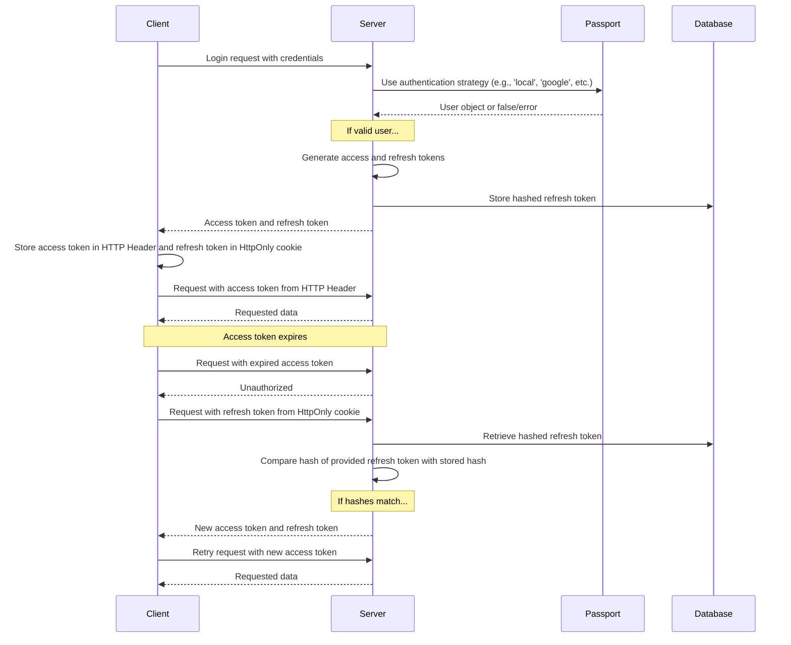

Was Benutzer beim Registrieren und Anmelden sehen, ist auf der Funktionsseite [Authentifizierung](/docs/features/authentication) beschrieben. Die anbieterspezifische Einrichtung befindet sich in den Anleitungen [OAuth2 und OpenID Connect](/docs/configuration/authentication/OAuth2-OIDC), [SAML](/docs/configuration/authentication/SAML), [LDAP](/docs/configuration/authentication/ldap), [E-Mail](/docs/configuration/authentication/email) und [Passkeys](/docs/configuration/authentication/passkeys). Erlaubte E-Mail-Domains und die Reihenfolge der Anmeldeschaltflächen werden im Block [`registration`](/docs/configuration/librechat_yaml/object_structure/registration) von `librechat.yaml` festgelegt.

In einer Single-Tenant-Bereitstellung erhält das zuerst registrierte Konto die Rolle `ADMIN`. Erstellen Sie dieses Konto daher selbst, bevor Sie die Registrierung für andere öffnen, und richten Sie es als lokales Konto mit E-Mail-Adresse und Passwort ein. Tenant-spezifische Bereitstellungen befördern niemals ihren ersten Benutzer; Tenant-Administratoren werden stattdessen über einen vertrauenswürdigen Verwaltungsablauf bereitgestellt.

## Allgemein [#general]

<OptionTable
  options={[
    ['ALLOW_EMAIL_LOGIN', 'boolean', 'Zeigt das E-Mail-Anmeldeformular an und akzeptiert lokale oder LDAP-Anmeldedaten über die Authentifizierungs-API.','ALLOW_EMAIL_LOGIN=true'],
    ['ALLOW_EMAIL_LOGIN_OVERRIDE', 'boolean', 'Weiterhin E-Mail-Anmeldung über die API akzeptieren, während ALLOW_EMAIL_LOGIN auf false gesetzt ist. Jede Verwendung wird protokolliert. Standardmäßig auskommentiert.','# ALLOW_EMAIL_LOGIN_OVERRIDE=false'],
    ['ALLOW_REGISTRATION', 'boolean', 'E-Mail-Registrierung für neue Benutzer aktivieren oder deaktivieren.','ALLOW_REGISTRATION=true'],
    ['ALLOW_SOCIAL_LOGIN', 'boolean', 'Erlauben Sie Benutzern, sich mit verschiedenen sozialen Netzwerken bei LibreChat anzumelden.','ALLOW_SOCIAL_LOGIN=false'],
    ['ALLOW_SOCIAL_REGISTRATION', 'boolean', 'Aktivieren oder deaktivieren Sie die Registrierung neuer Benutzer über verschiedene soziale Netzwerke.','ALLOW_SOCIAL_REGISTRATION=false'],
    ['ALLOW_ACCOUNT_DELETION', 'boolean', 'Zeige die Option „Konto löschen“ unter Einstellungen > Konto. Aktiviert, wenn nicht gesetzt.','# ALLOW_ACCOUNT_DELETION=true'],
    ['ALLOW_EMAIL_CHANGE', 'boolean', 'Benutzer mit E-Mail und Passwort können ihre E-Mail-Adresse unter Einstellungen > Konto ändern (E-Mail-Versand muss konfiguriert sein). Standardmäßig aktiviert, wenn nicht gesetzt. emailChange in librechat.yaml hat Vorrang. Siehe E-Mail-Adressänderung auf der Seite zur E-Mail-Einrichtung.','# ALLOW_EMAIL_CHANGE=true'],
  ]}
/>

> **Hinweis:** OpenID und SAML unterstützen nicht die Möglichkeit, nur die Registrierung zu deaktivieren.

Das Setzen von `ALLOW_EMAIL_LOGIN=false` blendet das E-Mail-Anmeldeformular aus und lehnt lokale oder LDAP-Anmeldeanfragen an `/api/auth/login` ab; OAuth, OpenID Connect und SAML-Anmeldungen sind davon nicht betroffen. `ALLOW_EMAIL_LOGIN_OVERRIDE=true` ist nur für eine kontrollierte API-Integration gedacht, die weiterhin eine Anmelde-Authentifizierung benötigt, während das Formular ausgeblendet ist. Jede Verwendung der Überschreibung protokolliert die IP-Adresse der Anfrage; schützen und überwachen Sie diese Route daher sorgfältig.

Kurztipps:

- Selbst wenn die Registrierung deaktiviert ist, können Sie Benutzer direkt zur Datenbank hinzufügen, indem Sie das unten beschriebene [create-user script](#create-user-script) verwenden.
- Um einen Benutzer zu löschen, können Sie das [delete-user Skript](#delete-user-script) verwenden, das ebenfalls unten aufgeführt ist.

<ThemeImage
  light="/images/features/authentication/register-light.png"
  dark="/images/features/authentication/register-dark.png"
  alt="Das Registrierungsformular „Create your account“ mit den Feldern Full name, Username (optional), Email, Password und Confirm password"
/>

## E-Mail-Verifizierung und Passwort-Zurücksetzen [#email-verification-and-password-reset]

Wenn ein [E-Mail-Dienst](/docs/configuration/authentication/email) konfiguriert ist, erhalten neue Konten mit E-Mail und Passwort einen Bestätigungslink. Ohne einen solchen Dienst werden Konten unmittelbar nach ihrer Erstellung als bestätigt markiert.

<OptionTable
  options={[
    ['ALLOW_UNVERIFIED_EMAIL_LOGIN', 'boolean', 'Erlaube Benutzern die Anmeldung, bevor ihre E-Mail-Adresse verifiziert ist. Bei false können nicht verifizierte Benutzer sich nicht anmelden, und Konten, die nie verifiziert werden, werden nach einer Woche gelöscht.','ALLOW_UNVERIFIED_EMAIL_LOGIN=true'],
    ['ALLOW_PASSWORD_RESET', 'boolean', 'Zeigt den Link „Passwort vergessen?“ an und erlaubt das Zurücksetzen von Passwörtern. Zurücksetzungslinks sind 15 Minuten gültig, und ein erfolgreiches Zurücksetzen beendet alle Sitzungen des Kontos. Ohne E-Mail-Dienst wird der Link jedem, der die Adresse eingibt, direkt auf der Seite angezeigt. Aktiviere dies daher nur zusammen mit E-Mail.','ALLOW_PASSWORD_RESET=false'],
  ]}
/>

## Zwei-Faktor-Authentifizierung [#two-factor-authentication]

E-Mail- und Passwort-Benutzer sowie LDAP-Benutzer können 2FA jederzeit selbst unter **Einstellungen > Konto** aktivieren. Konten, die sich über OAuth, OpenID Connect oder SAML anmelden, erhalten diese Option nicht, da ihr Identitätsanbieter für MFA zuständig ist.

### Erforderliche Zwei-Faktor-Authentifizierung [#required-two-factor-authentication]

Setzen Sie `ENFORCE_TWO_FACTOR_AUTHENTICATION=true`, um die Zwei-Faktor-Authentifizierung (2FA) für lokale Konten und LDAP-Konten verpflichtend zu machen:

- Ein Benutzer ohne 2FA, der sich anmeldet (mit Passwort, LDAP-Zugangsdaten oder einem Passkey), erhält keine Sitzung, bis die Einrichtung abgeschlossen ist. Er landet auf dem Bildschirm **Zwei-Faktor-Authentifizierung erforderlich**, scannt einen QR-Code, bestätigt einen Code und speichert seine Backup-Codes. Die Einrichtungssitzung ist 10 Minuten gültig; läuft sie ab, beginnt der Benutzer erneut auf der Anmeldeseite.
- Benutzer, die bereits angemeldet sind, werden beim nächsten Überprüfen oder Aktualisieren ihrer Sitzung in dieselbe Einrichtung geleitet, und Zugriffstokens, die vor der Registrierung ausgestellt wurden, funktionieren nicht mehr.
- Nach der Registrierung zeigt die Steuerung **Disable 2FA** den Hinweis **Required by administrator**, und der Server verweigert das Deaktivieren der 2FA. Benutzer können weiterhin Backup-Codes neu generieren.
- Ein föderiertes Konto, das sich bei aktivierter Durchsetzung mit einem Passwort anzumelden versucht, wird aufgefordert, stattdessen seinen Identity Provider zu verwenden.

<OptionTable
  options={[
    ['ENFORCE_TWO_FACTOR_AUTHENTICATION', 'boolean', 'Erfordert, dass sich lokale und LDAP-Konten für 2FA registrieren, bevor eine vollständige Sitzung ausgestellt wird. Standard: false.','ENFORCE_TWO_FACTOR_AUTHENTICATION=false'],
    ['TWO_FACTOR_BACKUP_CODE_FORMAT', 'string', 'Format neu ausgestellter Backup-Codes: strong (Standard) oder legacy. Siehe Abschnitt Backup-Code-Kompatibilität unten.','# TWO_FACTOR_BACKUP_CODE_FORMAT=strong'],
  ]}
/>

`ENFORCE_TWO_FACTOR_AUTHENTICATION` und die Grenzwerte für 2FA-Versuche sind prozessweite Umgebungseinstellungen. Sie gelten, bevor eine Anfrage oder eine Mandantenkonfiguration verfügbar ist, daher können sie nicht in `librechat.yaml` oder pro Mandant gesetzt werden; setze dieselben Werte auf jedem Replikat. Die Grenzwerte für Code-Versuche (`TWO_FACTOR_TEMP_*`, `TWO_FACTOR_SETUP_*`) finden sich auf der Seite [Automated Moderation](/docs/configuration/mod_system#two-factor-and-passkey-rate-limiting). Das separate Kontingent für die Verwaltung von 2FA über die Einstellungen ist [`rateLimits.twoFactorManagement`](/docs/configuration/librechat_yaml/object_structure/config#ratelimits) in `librechat.yaml`.

## Passkeys [#passkeys]

Passkeys (WebAuthn) ermöglichen es Benutzern, sich mit der Bildschirmsperre eines Geräts oder einem Sicherheitsschlüssel anzumelden. Sie sind standardmäßig deaktiviert; aktivieren Sie sie mit `ALLOW_PASSKEY_LOGIN=true`. Die Einstellungen der vertrauenden Partei, das Limit pro Benutzer und die Ratenbegrenzungen finden Sie auf der Seite [Passkeys](/docs/configuration/authentication/passkeys).

## Sitzungsablauf und Refresh Token [#session-expiry-and-refresh-token]

`SESSION_EXPIRY` ist die Gültigkeitsdauer eines Zugriffstokens (standardmäßig 15 Minuten); es wird im Hintergrund automatisch erneuert. `REFRESH_TOKEN_EXPIRY` ist die Dauer, für die ein Benutzer angemeldet bleibt (standardmäßig 7 Tage). Jede Erneuerung stellt ein neues Refresh-Token aus, das an dieselbe Sitzung und deren ursprüngliches Ablaufdatum gebunden ist. Das Zeitfenster wird daher ab dem Login gezählt, und Aktivität verlängert es nicht. Wenn Benutzer früher als gewünscht abgemeldet werden, erhöhen Sie `REFRESH_TOKEN_EXPIRY`.

Mit [`OPENID_REUSE_TOKENS=true`](/docs/configuration/authentication/OAuth2-OIDC/token-reuse) hält das Sitzungs-Cookie stattdessen das Refresh-Token des Identity Providers. Damit entscheiden die Lebensdauer, die Rotationsrichtlinie und die Widerrufsrichtlinie des Providers darüber, wann die Sitzung endet. `REFRESH_TOKEN_EXPIRY` kann ein abgelaufenes oder widerrufenes IdP-Token nicht verlängern.

<OptionTable
  options={[
    ['SESSION_EXPIRY', 'integer (milliseconds)', 'Zeit bis zum Sitzungsablauf.','SESSION_EXPIRY=1000 * 60 * 15'],
    ['REFRESH_TOKEN_EXPIRY', 'integer (milliseconds)', 'Ablaufzeit des Refresh-Tokens.','REFRESH_TOKEN_EXPIRY=(1000 * 60 * 60 * 24) * 7'],
    ['SESSION_COOKIE_SECURE', 'boolean', 'Erzwingt das Secure-Attribut für Sitzungs- und Authentifizierungs-Cookies auf ein (true) oder aus (false). Lassen Sie es unset, um anhand von NODE_ENV und DOMAIN_SERVER zu entscheiden. Setzen Sie es nur auf false für reine HTTP-Bereitstellungen, bei denen Browser Secure-Cookies verwerfen.','# SESSION_COOKIE_SECURE=false'],
  ]}
/>



## JWT Secret und Refresh Secret [#jwt-secret-and-refresh-secret]

- Wenn diese Werte leer bleiben, erzeugt LibreChat temporäre Geheimnisse in `.env.temp`. Legen Sie vor dem Betrieb einer Produktionsinstanz Ihre eigenen, dauerhaften Werte fest. Die angegebenen Beispiele sind 32-Byte-Schlüssel (64 Zeichen in Hexadezimal).
  - Verwenden Sie dieses Tool, um schnell einige zu generieren: **[JWT-Schlüssel](/toolkit/creds_generator)**

<OptionTable
  options={[
    ['JWT_SECRET', 'string (hex)', 'JWT-Geheimschlüssel.','JWT_SECRET='],
    ['JWT_REFRESH_SECRET', 'string (hex)', 'JWT-Refresh-Secret-Key.','JWT_REFRESH_SECRET='],
  ]}
/>

Verwenden Sie eindeutige Werte mit einer Länge von mindestens 32 Byte, speichern Sie diese sicher und stellen Sie sicher, dass jede LibreChat-Replik dieselben Werte erhält. Wenn einer der beiden Werte leer ist, kann LibreChat einen Wert generieren und aus seiner temporären Credentials-Datei wiederverwenden. Die standardmäßigen Docker-Compose-Stacks speichern diese Datei dauerhaft, dies ist jedoch nur als Hilfe für den initialen Start gedacht. Wenn die Datei verloren geht oder nicht geschrieben werden kann, können Sitzungen nach einem Neustart ungültig werden. Informationen zur Rangfolge, Persistenz und zu Empfehlungen für den Produktivbetrieb finden Sie unter [Credentials Configuration](/docs/configuration/dotenv#credentials-configuration).

---

## Automatisierte Moderation [#automated-moderation]

Anmeldung, Registrierung, Zurücksetzen des Passworts und Versuche der Zwei-Faktor-Authentifizierung (2FA) sind ratenbegrenzt, und wiederholte Verstöße führen zu vorübergehenden Sperren. Siehe [Automatische Moderation](/docs/configuration/mod_system).

## Benutzerverwaltungsskripte [#user-management-scripts]

### Benutzerskript erstellen [#create-user-script]

Verwende das Skript create-user, um Benutzer direkt in der Datenbank anzulegen, auch wenn die Registrierung deaktiviert ist:

1. Für die standardmäßige `docker-compose.yml` (falls Sie `docker compose up` verwenden, um die App zu starten):
   ```bash
   docker compose exec api npm run create-user
   ```

2. Für die `deploy-compose.yml` (falls Sie dem [Ubuntu Docker Guide](/docs/remote/docker_linux) gefolgt sind):
   ```bash
   docker exec -it LibreChat-API /bin/sh -c "cd .. && npm run create-user"
   ```

3. Für die lokale Entwicklung (vom Projektstammverzeichnis aus):
   ```bash
   npm run create-user
   ```

Befolgen Sie die Anweisungen, um die E-Mail-Adresse und das Passwort des neuen Benutzers einzugeben.

### Benutzer-Skript löschen [#delete-user-script]

Um einen Benutzer zu löschen, können Sie das delete-user Skript verwenden:

1. Für die standardmäßige `docker-compose.yml` (falls Sie `docker compose up` verwenden, um die App zu starten):
   ```bash
   docker compose exec api npm run delete-user email@domain.com
   ```

2. Für die `deploy-compose.yml` (falls Sie dem [Ubuntu Docker Guide](/docs/remote/docker_linux) gefolgt sind):
   ```bash
   docker exec -it LibreChat-API /bin/sh -c "cd .. && npm run delete-user email@domain.com"
   ```

3. Für die lokale Entwicklung (vom Projektstammverzeichnis aus):
   ```bash
   npm run delete-user email@domain.com
   ```

Ersetzen Sie `email@domain.com` durch die E-Mail-Adresse des Benutzers, den Sie löschen möchten.

## Backup-Code-Kompatibilität [#backup-code-compatibility]

Neue und neu generierte Backup-Codes verwenden standardmäßig zufällige 128-Bit-Werte mit individuell gesalzenen Hashes. Bestehende Legacy-Codes bleiben bis zu ihrer Neugenerierung nutzbar. `TWO_FACTOR_BACKUP_CODE_FORMAT=legacy` stellt vorübergehend das ältere 32-Bit-Format ohne Salt aus. Setzen Sie es auf jedem Replikat, solange inkompatible Backends oder Clients noch vorhanden sind, und entfernen Sie es anschließend. Rollen Sie nicht auf ein inkompatibles Backend zurück, nachdem starke Codes ausgestellt wurden, ohne diese zu ersetzen. Siehe [Leitfaden für rollierende Bereitstellungen](/docs/configuration/upgrade#mixed-version-compatibility).
