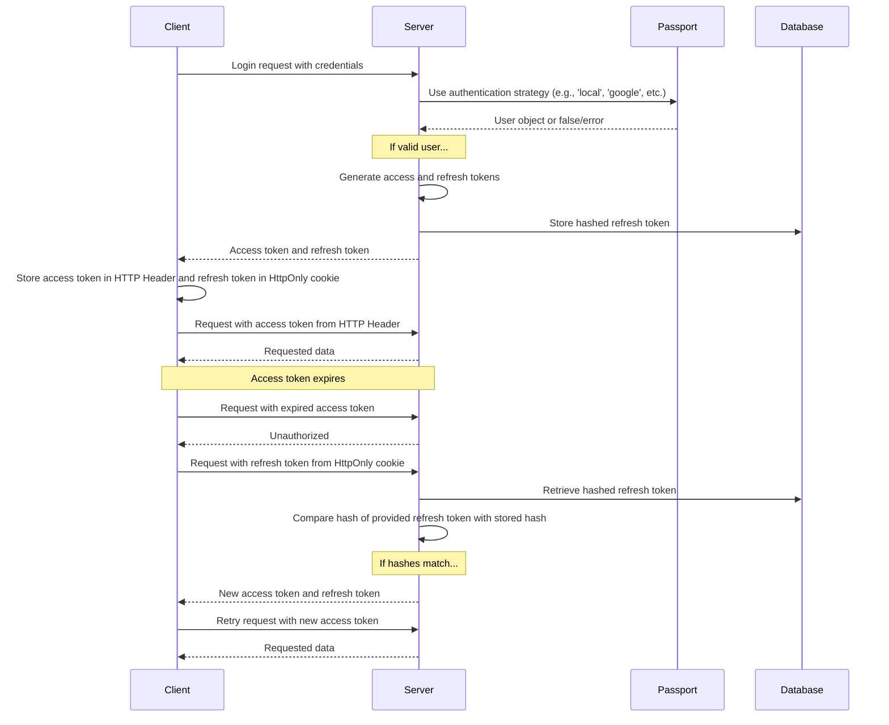

Ce que les utilisateurs voient lors de leur inscription et de leur connexion est décrit sur la page de fonctionnalité [Authentification](/docs/features/authentication). La configuration propre à chaque fournisseur se trouve dans les guides [OAuth2 et OpenID Connect](/docs/configuration/authentication/OAuth2-OIDC), [SAML](/docs/configuration/authentication/SAML), [LDAP](/docs/configuration/authentication/ldap), [e-mail](/docs/configuration/authentication/email) et [passkeys](/docs/configuration/authentication/passkeys). Les domaines d'e-mail autorisés et l'ordre des boutons de connexion sont définis dans le bloc [`registration`](/docs/configuration/librechat_yaml/object_structure/registration) de `librechat.yaml`.

Dans un déploiement mono-locataire, le premier compte enregistré reçoit le rôle `ADMIN`. Créez donc vous-même ce compte avant d'ouvrir l'inscription à d'autres utilisateurs, et faites-en un compte local avec adresse e-mail et mot de passe. Les déploiements à locataires multiples (scopés par tenant) ne promeuvent jamais leur premier utilisateur : provisionnez les administrateurs de locataire via un flux d'administration de confiance.

## Général [#general]

<OptionTable
  options={[
    ['ALLOW_EMAIL_LOGIN', 'boolean', 'Afficher le formulaire de connexion par e-mail et accepter les identifiants locaux ou LDAP via l\'API d\'authentification.','ALLOW_EMAIL_LOGIN=true'],
    ['ALLOW_EMAIL_LOGIN_OVERRIDE', 'boolean', 'Continuer à accepter la connexion par e-mail via l\'API tant que ALLOW_EMAIL_LOGIN est défini sur false. Chaque utilisation est journalisée. Commenté par défaut.','# ALLOW_EMAIL_LOGIN_OVERRIDE=false'],
    ['ALLOW_REGISTRATION', 'boolean', 'Activer ou désactiver l\'inscription par e-mail des nouveaux utilisateurs.','ALLOW_REGISTRATION=true'],
    ['ALLOW_SOCIAL_LOGIN', 'boolean', 'Permettre aux utilisateurs de se connecter à LibreChat avec divers réseaux sociaux.','ALLOW_SOCIAL_LOGIN=false'],
    ['ALLOW_SOCIAL_REGISTRATION', 'boolean', 'Activer ou désactiver l\'inscription de nouveaux utilisateurs via divers réseaux sociaux.','ALLOW_SOCIAL_REGISTRATION=false'],
    ['ALLOW_ACCOUNT_DELETION', 'boolean', 'Afficher l\'option Supprimer le compte dans Paramètres > Compte. Activée lorsqu\'elle n\'est pas définie.','# ALLOW_ACCOUNT_DELETION=true'],
    ['ALLOW_EMAIL_CHANGE', 'boolean', 'Permettre aux utilisateurs avec un compte e-mail et mot de passe de modifier leur adresse e-mail depuis Paramètres > Compte (la configuration de l\'e-mail est requise). Activé lorsque la valeur n\'est pas définie. emailChange dans librechat.yaml a la priorité. Voir Modification de l\'adresse e-mail sur la page de configuration de l\'e-mail.','# ALLOW_EMAIL_CHANGE=true'],
  ]}
/>

> **Note :** OpenID et SAML ne prennent pas en charge la possibilité de désactiver uniquement l'inscription.

Définir `ALLOW_EMAIL_LOGIN=false` masque le formulaire de connexion par e-mail et rejette les demandes d'identifiants locaux ou LDAP vers `/api/auth/login` ; les connexions OAuth, OpenID Connect et SAML ne sont pas affectées. `ALLOW_EMAIL_LOGIN_OVERRIDE=true` est destiné uniquement à une intégration API contrôlée qui nécessite toujours une connexion par identifiants alors que le formulaire est masqué. Chaque utilisation de la dérogation enregistre l'adresse IP de la requête, veillez donc à protéger et surveiller cette route avec attention.

Astuces rapides :

- Même si l'inscription est désactivée, vous pouvez ajouter des utilisateurs directement dans la base de données en utilisant [le script create-user](#create-user-script) détaillé ci-dessous.
- Pour supprimer un utilisateur, vous pouvez utiliser [le script delete-user](#delete-user-script) également détaillé ci-dessous.

<ThemeImage
  light="/images/features/authentication/register-light.png"
  dark="/images/features/authentication/register-dark.png"
  alt="Le formulaire d'inscription « Create your account » avec les champs Full name, Username (optional), Email, Password et Confirm password"
/>

## Vérification de l'e-mail et réinitialisation du mot de passe [#email-verification-and-password-reset]

Lorsqu'un [service d'e-mail](/docs/configuration/authentication/email) est configuré, les nouveaux comptes utilisant une adresse e-mail et un mot de passe reçoivent un lien de vérification. Sans service configuré, les comptes sont marqués comme vérifiés dès leur création.

<OptionTable
  options={[
    ['ALLOW_UNVERIFIED_EMAIL_LOGIN', 'boolean', 'Permettre aux utilisateurs de se connecter avant la vérification de leur adresse e-mail. Lorsque cette option est désactivée (false), les utilisateurs non vérifiés ne peuvent pas se connecter, et les comptes qui ne sont jamais vérifiés sont supprimés après une semaine.','ALLOW_UNVERIFIED_EMAIL_LOGIN=true'],
    ['ALLOW_PASSWORD_RESET', 'boolean', 'Afficher le lien « Mot de passe oublié ? » et autoriser la réinitialisation des mots de passe. Les liens de réinitialisation sont valables 15 minutes, et une réinitialisation réussie met fin à toutes les sessions du compte. Sans service de messagerie, le lien est affiché directement sur la page à quiconque saisit l\'adresse ; n\'activez donc cette option qu\'avec un service de messagerie.','ALLOW_PASSWORD_RESET=false'],
  ]}
/>

## Authentification à deux facteurs [#two-factor-authentication]

Les utilisateurs disposant d'un compte avec e-mail et mot de passe, ainsi que les utilisateurs LDAP, peuvent toujours activer eux-mêmes l'authentification à deux facteurs (2FA) depuis **Paramètres > Compte**. Les comptes qui se connectent via OAuth, OpenID Connect ou SAML n'ont pas cette option, car leur fournisseur d'identité est responsable de l'authentification multifacteur (MFA).

### Authentification à deux facteurs obligatoire [#required-two-factor-authentication]

Définissez `ENFORCE_TWO_FACTOR_AUTHENTICATION=true` pour rendre l'authentification à deux facteurs (2FA) obligatoire pour les comptes locaux et LDAP :

- Un utilisateur sans 2FA qui se connecte (avec un mot de passe, des identifiants LDAP ou une clé d'accès) n'obtient aucune session tant que la configuration n'est pas terminée. Il arrive alors sur l'écran **Authentification à deux facteurs requise**, scanne un code QR, confirme un code et enregistre ses codes de secours. La session de configuration dure 10 minutes ; si elle expire, il doit recommencer depuis la page de connexion.
- Les utilisateurs déjà connectés sont redirigés vers la même configuration lors de la prochaine vérification ou actualisation de leur session, et les jetons d'accès émis avant l'inscription cessent de fonctionner.
- Après l'inscription, le contrôle **Disable 2FA** affiche **Required by administrator** et le serveur refuse de désactiver la 2FA. Les utilisateurs peuvent toujours régénérer leurs codes de secours.
- Un compte fédéré qui tente de se connecter avec un mot de passe alors que l'application est active se voit indiquer d'utiliser son fournisseur d'identité.

<OptionTable
  options={[
    ['ENFORCE_TWO_FACTOR_AUTHENTICATION', 'boolean', 'Exiger que les comptes locaux et LDAP s\'inscrivent à la 2FA avant qu\'une session complète ne soit délivrée. Par défaut : false.','ENFORCE_TWO_FACTOR_AUTHENTICATION=false'],
    ['TWO_FACTOR_BACKUP_CODE_FORMAT', 'string', 'Format des codes de secours nouvellement émis : robuste (par défaut) ou hérité. Voir Compatibilité des codes de secours ci-dessous.','# TWO_FACTOR_BACKUP_CODE_FORMAT=strong'],
  ]}
/>

`ENFORCE_TWO_FACTOR_AUTHENTICATION` et les limites de tentatives 2FA sont des paramètres d'environnement à l'échelle du processus. Ils s'appliquent avant qu'une requête ou une configuration de locataire ne soit disponible ; ils ne peuvent donc pas être définis dans `librechat.yaml` ni par locataire. Définissez les mêmes valeurs sur chaque réplica. Les limites de tentatives de code (`TWO_FACTOR_TEMP_*`, `TWO_FACTOR_SETUP_*`) sont décrites sur la page [Modération automatisée](/docs/configuration/mod_system#two-factor-and-passkey-rate-limiting). Le budget distinct pour la gestion de la 2FA depuis les Paramètres est [`rateLimits.twoFactorManagement`](/docs/configuration/librechat_yaml/object_structure/config#ratelimits) dans `librechat.yaml`.

## Passkeys [#passkeys]

Les clés d'accès (WebAuthn) permettent aux utilisateurs de se connecter à l'aide du verrouillage d'écran de leur appareil ou d'une clé de sécurité. Elles sont désactivées par défaut ; activez-les avec `ALLOW_PASSKEY_LOGIN=true`. Les paramètres de la partie utúnica (relying party), la limite par utilisateur et les limites de débit se trouvent sur la page [Clés d'accès](/docs/configuration/authentication/passkeys).

## Expiration de session et jeton de rafraîchissement [#session-expiry-and-refresh-token]

`SESSION_EXPIRY` correspond à durée de validité d'un jeton d'accès (15 minutes par défaut) ; il est renouvelé automatiquement en arrière-plan. `REFRESH_TOKEN_EXPIRY` correspond à la durée pendant laquelle un utilisateur reste connecté (7 jours par défaut). Chaque renouvellement émet un nouveau jeton de rafraîchissement lié à la même session et à son expiration d'origine : la fenêtre se compte donc à partir de la connexion, et l'activité ne la prolonge pas. Si les utilisateurs sont déconnectés plus tôt que souhaité, augmentez `REFRESH_TOKEN_EXPIRY`.

Avec [`OPENID_REUSE_TOKENS=true`](/docs/configuration/authentication/OAuth2-OIDC/token-reuse), le cookie de session contient à la place le jeton d'actualisation (refresh token) du fournisseur d'identité ; c'est donc la durée de vie, la rotation et la politique de révocation de ce fournisseur qui déterminent la fin de la session. `REFRESH_TOKEN_EXPIRY` ne peut pas prolonger un jeton IdP expiré ou révoqué.

<OptionTable
  options={[
    ['SESSION_EXPIRY', 'integer (milliseconds)', 'Délai d\'expiration de la session.','SESSION_EXPIRY=1000 * 60 * 15'],
    ['REFRESH_TOKEN_EXPIRY', 'integer (milliseconds)', 'Délai d\'expiration du jeton de rafraîchissement.','REFRESH_TOKEN_EXPIRY=(1000 * 60 * 60 * 24) * 7'],
    ['SESSION_COOKIE_SECURE', 'boolean', 'Forcer l\'attribut Secure sur les cookies de session et d\'authentification à activé (true) ou désactivé (false). Ne rien définir pour le décider à partir de NODE_ENV et DOMAIN_SERVER. Ne définir false que pour les déploiements HTTP simples où les navigateurs rejettent les cookies Secure.','# SESSION_COOKIE_SECURE=false'],
  ]}
/>



## JWT Secret et Refresh Secret [#jwt-secret-and-refresh-secret]

- Si ces valeurs sont laissées vides, LibreChat génère des secrets temporaires dans `.env.temp`. Définissez vos propres valeurs persistantes avant d'exécuter une instance de production. Les exemples donnés sont des clés de 32 octets (64 caractères en hexadécimal).
  - Utilisez cet outil pour en générer rapidement : **[Clés JWT](/toolkit/creds_generator)**

<OptionTable
  options={[
    ['JWT_SECRET', 'string (hex)', 'Clé secrète JWT.','JWT_SECRET='],
    ['JWT_REFRESH_SECRET', 'string (hex)', 'Clé secrète de rafraîchissement JWT.','JWT_REFRESH_SECRET='],
  ]}
/>

Utilisez des valeurs uniques d'au moins 32 octets, stockez-les de manière sécurisée et attribuez les mêmes valeurs à chaque réplique de LibreChat. Lorsque l'une ou l'autre valeur est vide, LibreChat peut générer une valeur et la réutiliser à partir de son fichier d'identifiants temporaires. Les stacks Docker Compose par défaut conservent ce fichier, mais cette fonctionnalité est uniquement destinée à faciliter le démarrage. Si le fichier est perdu ou ne peut pas être écrit, les sessions peuvent devenir invalides après un redémarrage. Consultez [Credentials Configuration](/docs/configuration/dotenv#credentials-configuration) pour connaître l'ordre de priorité, la persistance et les recommandations pour la production.

---

## Modération automatisée [#automated-moderation]

Les tentatives de connexion, d'inscription, de réinitialisation de mot de passe et d'authentification à deux facteurs (2FA) sont soumises à une limitation de débit, et les infractions répétées entraînent des bannissements temporaires. Voir [Modération automatisée](/docs/configuration/mod_system).

## Scripts de gestion des utilisateurs [#user-management-scripts]

### Créer un script utilisateur [#create-user-script]

Utilisez le script create-user pour ajouter des utilisateurs directement dans la base de données, même lorsque l'inscription est désactivée :

1. Pour le `docker-compose.yml` par défaut (si vous utilisez `docker compose up` pour démarrer l'application) :
   ```bash
   docker compose exec api npm run create-user
   ```

2. Pour le `deploy-compose.yml` (si vous avez suivi le [Guide Docker Ubuntu](/docs/remote/docker_linux)) :
   ```bash
   docker exec -it LibreChat-API /bin/sh -c "cd .. && npm run create-user"
   ```

3. Pour le développement local (depuis la racine du projet) :
   ```bash
   npm run create-user
   ```

Suivez les instructions pour saisir l'e-mail et le mot de passe du nouvel utilisateur.

### Script de suppression d'utilisateur [#delete-user-script]

Pour supprimer un utilisateur, vous pouvez utiliser le script delete-user :

1. Pour le `docker-compose.yml` par défaut (si vous utilisez `docker compose up` pour démarrer l'application) :
   ```bash
   docker compose exec api npm run delete-user email@domain.com
   ```

2. Pour le `deploy-compose.yml` (si vous avez suivi le [Guide Docker Ubuntu](/docs/remote/docker_linux)) :
   ```bash
   docker exec -it LibreChat-API /bin/sh -c "cd .. && npm run delete-user email@domain.com"
   ```

3. Pour le développement local (depuis la racine du projet) :
   ```bash
   npm run delete-user email@domain.com
   ```

Remplacez `email@domain.com` par l'adresse e-mail de l'utilisateur que vous souhaitez supprimer.

## Compatibilité des codes de secours [#backup-code-compatibility]

Les nouveaux codes de secours, ainsi que ceux régénérés, utilisent par défaut des valeurs aléatoires de 128 bits, avec des hachages salés individuellement. Les codes hérités existants restent utilisables jusqu'à leur régénération. `TWO_FACTOR_BACKUP_CODE_FORMAT=legacy` émet temporairement l'ancien format de 32 bits, sans sel. Appliquez-le à chaque réplique tant que des backends ou clients incompatibles subsistent, puis supprimez-le. Ne revenez pas à un backend incompatible après avoir émis des codes forts sans les remplacer. Voir [consignes de déploiement progressif](/docs/configuration/upgrade#mixed-version-compatibility).
