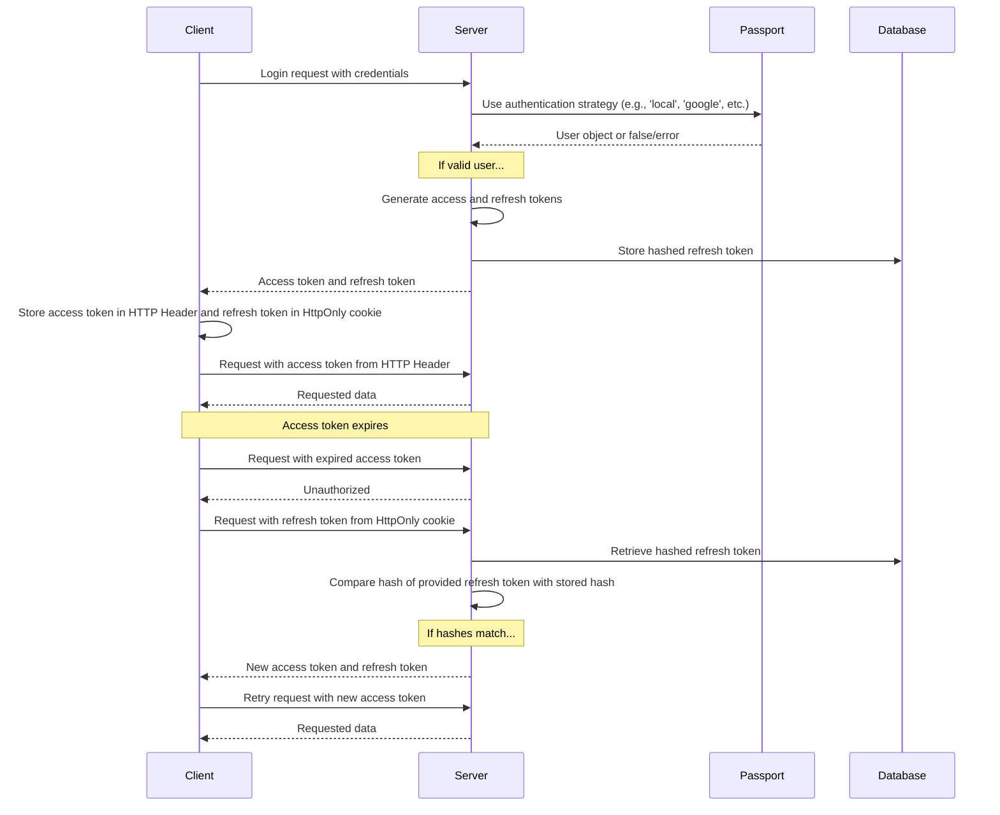

Apa yang dilihat pengguna saat mendaftar dan masuk dijelaskan pada halaman fitur [Authentication](/docs/features/authentication). Pengaturan khusus setiap penyedia tersedia di panduan [OAuth2 dan OpenID Connect](/docs/configuration/authentication/OAuth2-OIDC), [SAML](/docs/configuration/authentication/SAML), [LDAP](/docs/configuration/authentication/ldap), [email](/docs/configuration/authentication/email), dan [passkeys](/docs/configuration/authentication/passkeys). Domain email yang diizinkan dan urutan tombol login diatur dalam blok [`registration`](/docs/configuration/librechat_yaml/object_structure/registration) pada `librechat.yaml`.

Dalam deployment single-tenant, akun pertama yang didaftarkan akan mendapatkan peran `ADMIN`, jadi buatlah akun tersebut sendiri sebelum membuka pendaftaran untuk pengguna lain, dan pastikan akun tersebut berupa akun email dan kata sandi lokal. Deployment tenant-scoped tidak pernah mempromosikan pengguna pertamanya; sediakan admin tenant melalui alur administratif tepercaya.

## Umum [#general]

<OptionTable
  options={[
    ['ALLOW_EMAIL_LOGIN', 'boolean', 'Tampilkan formulir login email dan terima login kredensial lokal atau LDAP melalui API autentikasi.','ALLOW_EMAIL_LOGIN=true'],
    ['ALLOW_EMAIL_LOGIN_OVERRIDE', 'boolean', 'Tetap terima login email melalui API selama ALLOW_EMAIL_LOGIN bernilai false. Setiap penggunaan dicatat. Secara default dikomentari.','# ALLOW_EMAIL_LOGIN_OVERRIDE=false'],
    ['ALLOW_REGISTRATION', 'boolean', 'Aktifkan atau nonaktifkan pendaftaran Email untuk pengguna baru.','ALLOW_REGISTRATION=true'],
    ['ALLOW_SOCIAL_LOGIN', 'boolean', 'Izinkan pengguna untuk terhubung ke LibreChat dengan berbagai jejaring sosial.','ALLOW_SOCIAL_LOGIN=false'],
    ['ALLOW_SOCIAL_REGISTRATION', 'boolean', 'Aktifkan atau nonaktifkan pendaftaran pengguna baru menggunakan berbagai jejaring sosial.','ALLOW_SOCIAL_REGISTRATION=false'],
    ['ALLOW_ACCOUNT_DELETION', 'boolean', 'Tampilkan opsi Hapus akun di Settings > Account. Diaktifkan saat tidak diatur.','# ALLOW_ACCOUNT_DELETION=true'],
    ['ALLOW_EMAIL_CHANGE', 'boolean', 'Izinkan pengguna email dan kata sandi untuk mengubah alamat email mereka dari Pengaturan > Akun (memerlukan email yang sudah dikonfigurasi). Diaktifkan jika tidak diatur. emailChange di librechat.yaml memiliki prioritas. Lihat Perubahan alamat email pada halaman pengaturan email.','# ALLOW_EMAIL_CHANGE=true'],
  ]}
/>

> **Catatan:** OpenID dan SAML tidak mendukung kemampuan untuk menonaktifkan pendaftaran saja.

Mengatur `ALLOW_EMAIL_LOGIN=false` akan menyembunyikan formulir masuk email dan menolak permintaan kredensial lokal atau LDAP ke `/api/auth/login`; masuk melalui OAuth, OpenID Connect, dan SAML tidak akan terpengaruh. `ALLOW_EMAIL_LOGIN_OVERRIDE=true` ditujukan hanya untuk integrasi API terkontrol yang masih memerlukan masuk dengan kredensial saat formulir disembunyikan. Setiap penggunaan override akan mencatat IP permintaan, jadi lindungi dan pantau rute tersebut dengan cermat.

Tips Cepat:

- Bahkan dengan pendaftaran dinonaktifkan, Anda dapat menambahkan pengguna secara langsung ke basis data menggunakan [skrip create-user](#create-user-script) yang dirinci di bawah ini.
- Untuk menghapus pengguna, Anda dapat menggunakan [skrip delete-user](#delete-user-script) yang juga dijelaskan secara rinci di bawah ini.

<ThemeImage
  light="/images/features/authentication/register-light.png"
  dark="/images/features/authentication/register-dark.png"
  alt="Formulir pendaftaran Buat akun Anda dengan kolom Nama lengkap, Nama pengguna (opsional), Email, Kata sandi, dan Konfirmasi kata sandi"
/>

## Verifikasi email dan pengaturan ulang kata sandi [#email-verification-and-password-reset]

Ketika [layanan email](/docs/configuration/authentication/email) dikonfigurasi, akun email dan kata sandi baru akan menerima tautan verifikasi. Tanpa layanan tersebut, akun akan langsung ditandai sebagai terverifikasi saat dibuat.

<OptionTable
  options={[
    ['ALLOW_UNVERIFIED_EMAIL_LOGIN', 'boolean', 'Izinkan pengguna untuk masuk sebelum memverifikasi email mereka. Jika bernilai false, pengguna yang belum terverifikasi tidak dapat masuk, dan akun yang tidak pernah diverifikasi akan dihapus setelah satu minggu.','ALLOW_UNVERIFIED_EMAIL_LOGIN=true'],
    ['ALLOW_PASSWORD_RESET', 'boolean', 'Tampilkan tautan Lupa Kata Sandi? dan izinkan pengaturan ulang kata sandi. Tautan pengaturan ulang berlaku selama 15 menit, dan pengaturan ulang yang berhasil akan mengakhiri semua sesi akun tersebut. Tanpa layanan email, tautan akan ditampilkan langsung di halaman kepada siapa pun yang memasukkan alamat email, sehingga aktifkan fitur ini hanya bersama dengan email.','ALLOW_PASSWORD_RESET=false'],
  ]}
/>

## Autentikasi dua faktor [#two-factor-authentication]

Pengguna email dan kata sandi serta pengguna LDAP selalu dapat mengaktifkan 2FA sendiri dari **Settings > Account**. Akun yang masuk melalui OAuth, OpenID Connect, atau SAML tidak mendapatkan opsi ini, karena penyedia identitas mereka yang bertanggung jawab atas MFA.

### Autentikasi dua faktor yang diwajibkan [#required-two-factor-authentication]

Setel `ENFORCE_TWO_FACTOR_AUTHENTICATION=true` untuk membuat 2FA wajib bagi akun lokal dan LDAP:

- Pengguna tanpa 2FA yang masuk (dengan kata sandi, kredensial LDAP, atau passkey) tidak akan mendapatkan sesi sampai penyiapan selesai. Mereka akan dibawa ke layar **Two-Factor Authentication Required**, memindai kode QR, mengonfirmasi kode, dan menyimpan kode cadangan mereka. Sesi penyiapan berlaku selama 10 menit; jika kedaluwarsa, mereka harus memulai lagi dari halaman login.
- Pengguna yang sudah masuk akan diarahkan ke pengaturan yang sama saat sesi mereka diperiksa atau disegarkan berikutnya, dan token akses yang diterbitkan sebelum pendaftaran tidak lagi berfungsi.
- Setelah pendaftaran, kontrol **Disable 2FA** menampilkan **Required by administrator** dan server menolak untuk menonaktifkan 2FA. Pengguna masih dapat membuat ulang kode cadangan.
- Akun terfederasi yang mencoba masuk dengan kata sandi saat penegakan aktif akan diminta untuk menggunakan penyedia identitasnya.

<OptionTable
  options={[
    ['ENFORCE_TWO_FACTOR_AUTHENTICATION', 'boolean', 'Wajibkan akun lokal dan LDAP untuk mendaftar 2FA sebelum sesi penuh diberikan. Default: false.','ENFORCE_TWO_FACTOR_AUTHENTICATION=false'],
    ['TWO_FACTOR_BACKUP_CODE_FORMAT', 'string', 'Format kode cadangan yang baru diterbitkan: strong (default) atau legacy. Lihat Kompatibilitas kode cadangan di bawah.','# TWO_FACTOR_BACKUP_CODE_FORMAT=strong'],
  ]}
/>

`ENFORCE_TWO_FACTOR_AUTHENTICATION` dan batas percobaan 2FA adalah pengaturan lingkungan tingkat proses. Pengaturan ini berlaku sebelum permintaan atau konfigurasi tenant apa pun tersedia, sehingga tidak dapat diatur di `librechat.yaml` maupun per tenant; atur nilai yang sama pada setiap replika. Batas percobaan kode (`TWO_FACTOR_TEMP_*`, `TWO_FACTOR_SETUP_*`) dijelaskan di halaman [Automated Moderation](/docs/configuration/mod_system#two-factor-and-passkey-rate-limiting). Anggaran terpisah untuk mengelola 2FA dari Settings adalah [`rateLimits.twoFactorManagement`](/docs/configuration/librechat_yaml/object_structure/config#ratelimits) di `librechat.yaml`.

## Passkeys [#passkeys]

Passkey (WebAuthn) memungkinkan pengguna untuk masuk dengan kunci layar perangkat atau kunci keamanan. Fitur ini nonaktif secara default; aktifkan dengan `ALLOW_PASSKEY_LOGIN=true`. Pengaturan relying party, batas per pengguna, dan batas laju (rate limit) tersedia di halaman [Passkeys](/docs/configuration/authentication/passkeys).

## Kedaluwarsa Sesi dan Refresh Token [#session-expiry-and-refresh-token]

`SESSION_EXPIRY` adalah lama masa berlaku access token (secara default 15 menit); token ini diperbarui secara otomatis di latar belakang. `REFRESH_TOKEN_EXPIRY` adalah lama pengguna tetap masuk (secara default 7 hari). Setiap pembaruan menerbitkan refresh token baru yang terikat pada sesi yang sama dan masa berlaku aslinya, sehingga jendela waktu dihitung sejak login dan aktivitas tidak memperpanjangnya. Jika pengguna keluar lebih cepat dari yang Anda inginkan, naikkan `REFRESH_TOKEN_EXPIRY`.

Dengan [`OPENID_REUSE_TOKENS=true`](/docs/configuration/authentication/OAuth2-OIDC/token-reuse), cookie sesi justru menyimpan refresh token dari identity provider, sehingga masa berlaku, rotasi, dan kebijakan pencabutan provider menentukan kapan sesi berakhir; `REFRESH_TOKEN_EXPIRY` tidak dapat memperpanjang token IdP yang sudah kedaluwarsa atau dicabut.

<OptionTable
  options={[
    ['SESSION_EXPIRY', 'integer (milliseconds)', 'Waktu kedaluwarsa sesi.','SESSION_EXPIRY=1000 * 60 * 15'],
    ['REFRESH_TOKEN_EXPIRY', 'integer (milliseconds)', 'Waktu kedaluwarsa refresh token.','REFRESH_TOKEN_EXPIRY=(1000 * 60 * 60 * 24) * 7'],
    ['SESSION_COOKIE_SECURE', 'boolean', 'Paksa atribut Secure pada cookie sesi dan autentikasi menjadi aktif (true) atau nonaktif (false). Biarkan tidak diatur untuk menentukan berdasarkan NODE_ENV dan DOMAIN_SERVER. Atur false hanya untuk deployment HTTP biasa, di mana browser membuang cookie Secure.','# SESSION_COOKIE_SECURE=false'],
  ]}
/>



## JWT Secret dan Refresh Secret [#jwt-secret-and-refresh-secret]

- Jika nilai-nilai ini dibiarkan kosong, LibreChat akan menghasilkan rahasia sementara di `.env.temp`. Atur nilai persisten Anda sendiri sebelum menjalankan instance produksi. Contoh yang diberikan adalah kunci 32-byte (64 karakter dalam heksadesimal).
  - Gunakan alat ini untuk membuat beberapa dengan cepat: **[JWT Keys](/toolkit/creds_generator)**

<OptionTable
  options={[
    ['JWT_SECRET', 'string (hex)', 'Kunci rahasia JWT.','JWT_SECRET='],
    ['JWT_REFRESH_SECRET', 'string (hex)', 'Kunci rahasia refresh JWT.','JWT_REFRESH_SECRET='],
  ]}
/>

Gunakan nilai unik dengan panjang minimal 32 byte, simpan dengan aman, dan berikan nilai yang sama untuk setiap replika LibreChat. Ketika salah satu nilai kosong, LibreChat dapat membuat dan menggunakan kembali nilai dari file kredensial sementaranya. Stack Docker Compose default menyimpan file tersebut secara persisten, tetapi hal ini hanya dimaksudkan sebagai kemudahan untuk bootstrap. Jika file hilang atau tidak dapat ditulis, sesi dapat menjadi tidak valid setelah restart. Lihat [Credentials Configuration](/docs/configuration/dotenv#credentials-configuration) untuk prioritas, persistensi, dan panduan produksi.

---

## Moderasi Otomatis [#automated-moderation]

Percobaan login, pendaftaran, pengaturan ulang kata sandi, dan 2FA dibatasi laju (rate limited), dan pelanggaran berulang akan mengakibatkan pemblokiran sementara. Lihat [Automated Moderation](/docs/configuration/mod_system).

## Skrip Manajemen Pengguna [#user-management-scripts]

### Membuat User Script [#create-user-script]

Gunakan skrip create-user untuk menambahkan pengguna langsung ke database, meskipun pendaftaran dinonaktifkan:

1. Untuk `docker-compose.yml` default (jika Anda menggunakan `docker compose up` untuk menjalankan aplikasi):
   ```bash
   docker compose exec api npm run create-user
   ```

2. Untuk `deploy-compose.yml` (jika Anda mengikuti [Panduan Docker Ubuntu](/docs/remote/docker_linux)):
   ```bash
   docker exec -it LibreChat-API /bin/sh -c "cd .. && npm run create-user"
   ```

3. Untuk pengembangan lokal (dari root proyek):
   ```bash
   npm run create-user
   ```

Ikuti perintah untuk memasukkan email dan kata sandi pengguna baru.

### Skrip Hapus Pengguna [#delete-user-script]

Untuk menghapus pengguna, Anda dapat menggunakan skrip delete-user:

1. Untuk `docker-compose.yml` default (jika Anda menggunakan `docker compose up` untuk menjalankan aplikasi):
   ```bash
   docker compose exec api npm run delete-user email@domain.com
   ```

2. Untuk `deploy-compose.yml` (jika Anda mengikuti [Panduan Docker Ubuntu](/docs/remote/docker_linux)):
   ```bash
   docker exec -it LibreChat-API /bin/sh -c "cd .. && npm run delete-user email@domain.com"
   ```

3. Untuk pengembangan lokal (dari root proyek):
   ```bash
   npm run delete-user email@domain.com
   ```

Ganti `email@domain.com` dengan email pengguna yang ingin Anda hapus.

## Kompatibilitas kode cadangan [#backup-code-compatibility]

Kode cadangan baru dan yang dibuat ulang secara default menggunakan nilai acak 128-bit dengan hash yang masing-masing diberi salt secara individual. Kode lama (legacy) yang sudah ada tetap dapat digunakan hingga dibuat ulang. `TWO_FACTOR_BACKUP_CODE_FORMAT=legacy` sementara waktu menerbitkan format lama 32-bit yang tidak menggunakan salt. Terapkan pengaturan ini ke setiap replika selama backend atau klien yang tidak kompatibel masih ada, lalu hapus pengaturan tersebut. Jangan kembali (roll back) ke backend yang tidak kompatibel setelah menerbitkan kode yang kuat tanpa menggantinya. Lihat [panduan penerapan bertahap](/docs/configuration/upgrade#mixed-version-compatibility).
