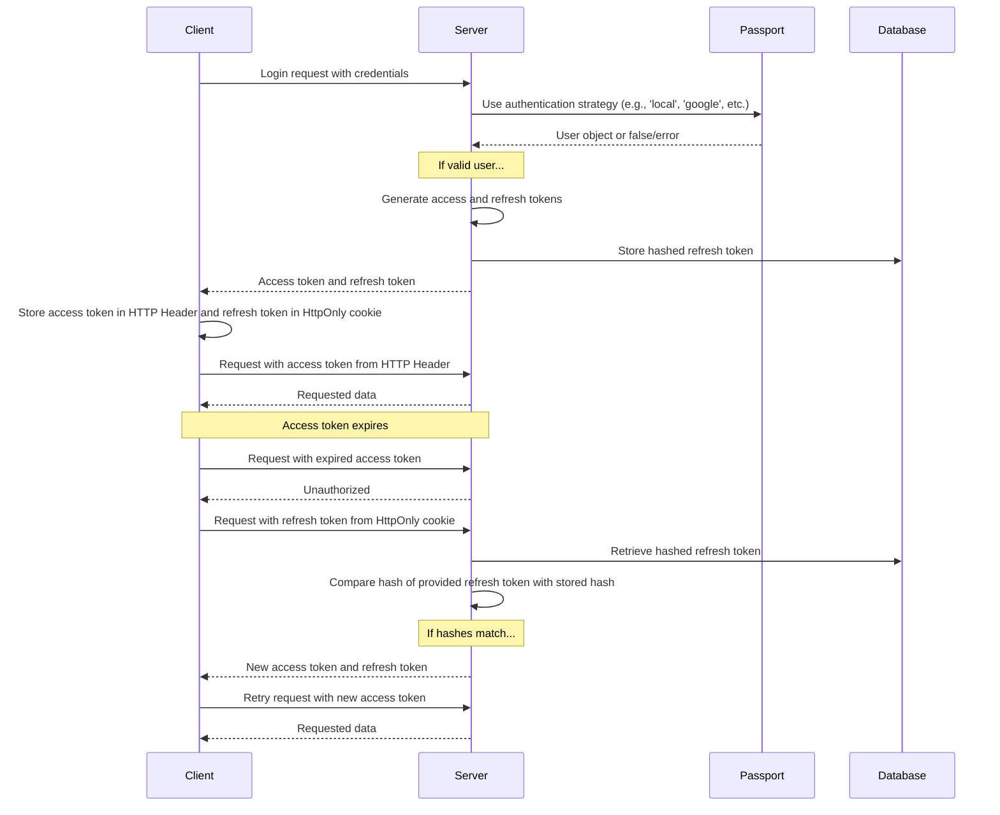

What users see when they sign up and sign in is described on the [Authentication](/docs/features/authentication) feature page. Provider-specific setup lives in the [OAuth2 and OpenID Connect](/docs/configuration/authentication/OAuth2-OIDC), [SAML](/docs/configuration/authentication/SAML), [LDAP](/docs/configuration/authentication/ldap), [email](/docs/configuration/authentication/email), and [passkeys](/docs/configuration/authentication/passkeys) guides. Allowed email domains and the order of the login buttons are set in the [`registration`](/docs/configuration/librechat_yaml/object_structure/registration) block of `librechat.yaml`.

In a single-tenant deployment, the first account registered gets the `ADMIN` role, so create it yourself before opening registration to others, and make it a local email and password account. Tenant-scoped deployments never promote their first user; provision tenant admins through a trusted administrative flow.

## 一般 [#general]

<OptionTable
  options={[
    ['ALLOW_EMAIL_LOGIN', 'boolean', 'Show the email login form and accept local or LDAP credential logins through the authentication API.','ALLOW_EMAIL_LOGIN=true'],
    ['ALLOW_EMAIL_LOGIN_OVERRIDE', 'boolean', 'Still accept email login through the API while ALLOW_EMAIL_LOGIN is false. Each use is logged. Commented out by default.','# ALLOW_EMAIL_LOGIN_OVERRIDE=false'],
    ['ALLOW_REGISTRATION', 'boolean', '新規ユーザーのメール登録を有効または無効にします。','ALLOW_REGISTRATION=true'],
    ['ALLOW_SOCIAL_LOGIN', 'boolean', 'ユーザーがさまざまなソーシャルネットワークを使用してLibreChatに接続できるようにします。','ALLOW_SOCIAL_LOGIN=false'],
    ['ALLOW_SOCIAL_REGISTRATION', 'boolean', 'さまざまなソーシャルネットワークを使用した新規ユーザーの登録を有効または無効にします。','ALLOW_SOCIAL_REGISTRATION=false'],
    ['ALLOW_ACCOUNT_DELETION', 'boolean', 'Show the Delete account option in Settings > Account. Enabled when unset.','# ALLOW_ACCOUNT_DELETION=true'],
    ['ALLOW_EMAIL_CHANGE', 'boolean', 'Let email and password users change their email address from Settings > Account (needs email configured). Enabled when unset. emailChange in librechat.yaml takes precedence. See Email address change on the email setup page.','# ALLOW_EMAIL_CHANGE=true'],
  ]}
/>

> **注:** OpenID および SAML は、登録のみを無効にする機能をサポートしていません。

`ALLOW_EMAIL_LOGIN=false` を設定すると、メールログインフォームが非表示になり、`/api/auth/login` へのローカルまたはLDAP認証リクエストが拒否されます。OAuth、OpenID Connect、およびSAMLサインインには影響しません。`ALLOW_EMAIL_LOGIN_OVERRIDE=true` は、フォームが非表示の状態でも認証ログインを必要とする制御されたAPI統合のためにのみ意図されています。オーバーライドを使用するたびにリクエスト元のIPがログに記録されるため、そのルートを慎重に保護および監視してください。

クイックヒント:

- 登録が無効になっている場合でも、以下で詳述する [the create-user script](#create-user-script) を使用して、データベースに直接ユーザーを追加できます。
- ユーザーを削除するには、以下で詳しく説明されている[delete-userスクリプト](#delete-user-script)を使用できます。

<ThemeImage
  light="/images/features/authentication/register-light.png"
  dark="/images/features/authentication/register-dark.png"
  alt="The Create your account registration form with Full name, Username (optional), Email, Password, and Confirm password fields"
/>

## Email verification and password reset [#email-verification-and-password-reset]

When an [email service](/docs/configuration/authentication/email) is configured, new email and password accounts get a verification link. Without one, accounts are marked verified as soon as they are created.

<OptionTable
  options={[
    ['ALLOW_UNVERIFIED_EMAIL_LOGIN', 'boolean', 'Let users sign in before verifying their email. When false, unverified users cannot sign in, and accounts that are never verified are deleted after one week.','ALLOW_UNVERIFIED_EMAIL_LOGIN=true'],
    ['ALLOW_PASSWORD_RESET', 'boolean', 'Show the Forgot Password? link and allow password resets. Reset links are valid for 15 minutes, and a successful reset ends all of the account\'s sessions. Without an email service the link is shown directly on the page to anyone who enters the address, so only enable this together with email.','ALLOW_PASSWORD_RESET=false'],
  ]}
/>

## Two-factor authentication [#two-factor-authentication]

Email and password users and LDAP users can always turn on 2FA themselves from **Settings > Account**. Accounts that sign in through OAuth, OpenID Connect, or SAML do not get the option, because their identity provider is responsible for MFA.

### Required two-factor authentication [#required-two-factor-authentication]

Set `ENFORCE_TWO_FACTOR_AUTHENTICATION=true` to make 2FA mandatory for local and LDAP accounts:

- A user without 2FA who signs in (with a password, LDAP credentials, or a passkey) gets no session until setup is done. They land on the **Two-Factor Authentication Required** screen, scan a QR code, confirm a code, and save their backup codes. The setup session lasts 10 minutes; if it expires, they start again from the login page.
- Users who are already signed in are sent into the same setup the next time their session is checked or refreshed, and access tokens issued before enrollment stop working.
- After enrollment, the **Disable 2FA** control shows **Required by administrator** and the server refuses to turn 2FA off. Users can still regenerate backup codes.
- A federated account that tries to sign in with a password while enforcement is on is told to use its identity provider.

<OptionTable
  options={[
    ['ENFORCE_TWO_FACTOR_AUTHENTICATION', 'boolean', '完全なセッションが発行される前に、ローカルアカウントおよびLDAPアカウントに対して2FAの登録を必須にします。デフォルト: false。','ENFORCE_TWO_FACTOR_AUTHENTICATION=false'],
    ['TWO_FACTOR_BACKUP_CODE_FORMAT', 'string', 'Format of newly issued backup codes: strong (default) or legacy. See Backup-code compatibility below.','# TWO_FACTOR_BACKUP_CODE_FORMAT=strong'],
  ]}
/>

`ENFORCE_TWO_FACTOR_AUTHENTICATION` and the 2FA attempt limits are process-wide environment settings. They apply before any request or tenant configuration is available, so they cannot be set in `librechat.yaml` or per tenant; set the same values on every replica. The code-attempt limits (`TWO_FACTOR_TEMP_*`, `TWO_FACTOR_SETUP_*`) are on the [Automated Moderation](/docs/configuration/mod_system#two-factor-and-passkey-rate-limiting) page. The separate budget for managing 2FA from Settings is [`rateLimits.twoFactorManagement`](/docs/configuration/librechat_yaml/object_structure/config#ratelimits) in `librechat.yaml`.

## Passkeys [#passkeys]

Passkeys (WebAuthn) let users sign in with a device screen lock or a security key. They are off by default; turn them on with `ALLOW_PASSKEY_LOGIN=true`. The relying party settings, per-user limit, and rate limits are on the [Passkeys](/docs/configuration/authentication/passkeys) page.

## セッションの有効期限とリフレッシュトークン [#session-expiry-and-refresh-token]

`SESSION_EXPIRY` is how long an access token lasts (15 minutes by default); it is renewed automatically in the background. `REFRESH_TOKEN_EXPIRY` is how long a user stays signed in (7 days by default). Each renewal issues a new refresh token tied to the same session and its original expiry, so the window counts from login and activity does not extend it. If users are signed out sooner than you want, raise `REFRESH_TOKEN_EXPIRY`.

With [`OPENID_REUSE_TOKENS=true`](/docs/configuration/authentication/OAuth2-OIDC/token-reuse), the session cookie holds the identity provider's refresh token instead, so the provider's lifetime, rotation, and revocation policy decide when the session ends; `REFRESH_TOKEN_EXPIRY` cannot extend an expired or revoked IdP token.

<OptionTable
  options={[
    ['SESSION_EXPIRY', 'integer (milliseconds)', 'セッションの有効期限。','SESSION_EXPIRY=1000 * 60 * 15'],
    ['REFRESH_TOKEN_EXPIRY', 'integer (milliseconds)', 'リフレッシュトークンの有効期限。','REFRESH_TOKEN_EXPIRY=(1000 * 60 * 60 * 24) * 7'],
    ['SESSION_COOKIE_SECURE', 'boolean', 'Force the Secure attribute on session and auth cookies on (true) or off (false). Leave unset to decide from NODE_ENV and DOMAIN_SERVER. Set false only for plain HTTP deployments where browsers drop Secure cookies.','# SESSION_COOKIE_SECURE=false'],
  ]}
/>



## JWT Secret および Refresh Secret [#jwt-secret-and-refresh-secret]

- If these are left blank, LibreChat generates temporary secrets in `.env.temp`. Set your own persistent values before running a production instance. The examples given are 32-byte keys (64 characters in hex).
  - Use this tool to generate some quickly: **[JWT Keys](/toolkit/creds_generator)**

<OptionTable
  options={[
    ['JWT_SECRET', 'string (hex)', 'JWTシークレットキー','JWT_SECRET='],
    ['JWT_REFRESH_SECRET', 'string (hex)', 'JWTリフレッシュシークレットキー','JWT_REFRESH_SECRET='],
  ]}
/>

Use unique values of at least 32 bytes, store them securely, and give every LibreChat replica the same values. When either value is blank, LibreChat can generate and reuse a value from its temporary credentials file. The default Docker Compose stacks persist that file, but this is intended only as a bootstrap convenience. If the file is lost or cannot be written, sessions can become invalid after restart. See [Credentials Configuration](/docs/configuration/dotenv#credentials-configuration) for precedence, persistence, and production guidance.

---

## Automated Moderation [#automated-moderation]

Login, registration, password reset, and 2FA attempts are rate limited, and repeated violations lead to temporary bans. See [Automated Moderation](/docs/configuration/mod_system).

## ユーザー管理スクリプト [#user-management-scripts]

### ユーザー・スクリプトを作成する [#create-user-script]

Use the create-user script to add users directly to the database, even when registration is disabled:

1. デフォルトの `docker-compose.yml` の場合（`docker compose up` を使用してアプリを起動する場合）:
   ```bash
   docker compose exec api npm run create-user
   ```

2. `deploy-compose.yml` については（[Ubuntu Docker Guide](/docs/remote/docker_linux) に従った場合）：
   ```bash
   docker exec -it LibreChat-API /bin/sh -c "cd .. && npm run create-user"
   ```

3. ローカル開発用（プロジェクトルートから）:
   ```bash
   npm run create-user
   ```

プロンプトに従って、新しいユーザーのメールアドレスとパスワードを入力してください。

### ユーザー削除スクリプト [#delete-user-script]

ユーザーを削除するには、delete-userスクリプトを使用できます：

1. デフォルトの `docker-compose.yml` の場合（`docker compose up` を使用してアプリを起動する場合）:
   ```bash
   docker compose exec api npm run delete-user email@domain.com
   ```

2. `deploy-compose.yml` については（[Ubuntu Docker Guide](/docs/remote/docker_linux) に従った場合）：
   ```bash
   docker exec -it LibreChat-API /bin/sh -c "cd .. && npm run delete-user email@domain.com"
   ```

3. ローカル開発用（プロジェクトルートから）:
   ```bash
   npm run delete-user email@domain.com
   ```

`email@domain.com` を、削除したいユーザーのメールアドレスに置き換えてください。

## Backup-code compatibility [#backup-code-compatibility]

新規発行および再生成されたバックアップコードは、デフォルトで128ビットのランダムな値となり、各コードは個別にソルトを付与したハッシュで保存されます。既存のレガシーコードは、再生成されるまで引き続き使用できます。`TWO_FACTOR_BACKUP_CODE_FORMAT=legacy` を設定すると、一時的に旧形式である32ビットのソルトなしのコードが発行されます。非互換のバックエンドやクライアントが残っている間は、すべてのレプリカにこの設定を適用し、その後に削除してください。強力なコードを発行した後は、それを置き換えないまま非互換のバックエンドへロールバックしないでください。詳細は[ローリングデプロイメントのガイダンス](/docs/configuration/upgrade#mixed-version-compatibility)を参照してください。
