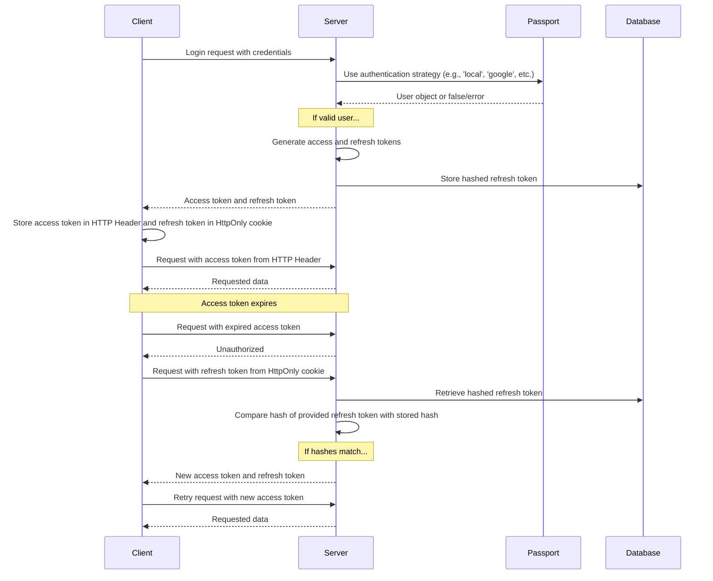

사용자가 가입하고 로그인할 때 보게 되는 화면은 [인증](/docs/features/authentication) 기능 페이지에 설명되어 있습니다. 제공자별 설정은 [OAuth2 및 OpenID Connect](/docs/configuration/authentication/OAuth2-OIDC), [SAML](/docs/configuration/authentication/SAML), [LDAP](/docs/configuration/authentication/ldap), [이메일](/docs/configuration/authentication/email), [패스키](/docs/configuration/authentication/passkeys) 가이드에서 다룹니다. 허용되는 이메일 도메인과 로그인 버튼의 순서는 `librechat.yaml`의 [`registration`](/docs/configuration/librechat_yaml/object_structure/registration) 블록에서 설정합니다.

단일 테넌트 배포에서는 가장 먼저 등록된 계정에 `ADMIN` 역할이 부여되므로, 다른 사용자에게 회원가입을 열기 전에 직접 계정을 생성하세요. 이때 로컬 이메일과 비밀번호를 사용하는 계정으로 만들어야 합니다. 테넌트 범위 배포에서는 첫 번째 사용자가 자동으로 관리자로 승격되지 않습니다. 대신 신뢰할 수 있는 관리 절차를 통해 테넌트 관리자를 프로비저닝하세요.

## 일반 [#general]

<OptionTable
  options={[
    ['ALLOW_EMAIL_LOGIN', 'boolean', '이메일 로그인 양식을 표시하고, 인증 API를 통해 로컬 또는 LDAP 자격 증명 로그인을 허용합니다.','ALLOW_EMAIL_LOGIN=true'],
    ['ALLOW_EMAIL_LOGIN_OVERRIDE', 'boolean', 'API를 통한 이메일 로그인은 ALLOW_EMAIL_LOGIN이 false인 상태에서도 계속 허용됩니다. 사용할 때마다 기록됩니다. 기본적으로 주석 처리되어 있습니다.','# ALLOW_EMAIL_LOGIN_OVERRIDE=false'],
    ['ALLOW_REGISTRATION', 'boolean', '새 사용자의 이메일 등록을 활성화하거나 비활성화합니다.','ALLOW_REGISTRATION=true'],
    ['ALLOW_SOCIAL_LOGIN', 'boolean', '사용자가 다양한 소셜 네트워크를 통해 LibreChat에 연결할 수 있도록 허용합니다.','ALLOW_SOCIAL_LOGIN=false'],
    ['ALLOW_SOCIAL_REGISTRATION', 'boolean', '다양한 소셜 네트워크를 사용하여 새 사용자 등록을 활성화하거나 비활성화합니다.','ALLOW_SOCIAL_REGISTRATION=false'],
    ['ALLOW_ACCOUNT_DELETION', 'boolean', 'Settings > Account에서 계정 삭제 옵션을 표시합니다. 설정되지 않은 경우 활성화됩니다.','# ALLOW_ACCOUNT_DELETION=true'],
    ['ALLOW_EMAIL_CHANGE', 'boolean', '이메일 및 비밀번호 사용자는 설정 > 계정에서 이메일 주소를 변경할 수 있습니다(이메일 구성 필요). 설정되지 않은 경우 기본적으로 활성화됩니다. librechat.yaml의 emailChange가 우선 적용됩니다. 이메일 설정 페이지의 이메일 주소 변경 항목을 참조하세요.','# ALLOW_EMAIL_CHANGE=true'],
  ]}
/>

> **참고:** OpenID 및 SAML은 등록만 비활성화하는 기능을 지원하지 않습니다.

`ALLOW_EMAIL_LOGIN=false`를 설정하면 이메일 로그인 폼이 숨겨지며 `/api/auth/login`에 대한 로컬 또는 LDAP 자격 증명 요청이 거부됩니다. OAuth, OpenID Connect 및 SAML 로그인은 영향을 받지 않습니다. `ALLOW_EMAIL_LOGIN_OVERRIDE=true`는 폼이 숨겨진 상태에서도 자격 증명 로그인이 필요한 제어된 API 통합을 위해서만 의도되었습니다. 모든 오버라이드 사용 시 요청 IP가 기록되므로 해당 경로를 주의 깊게 보호하고 모니터링하십시오.

빠른 팁:

- 등록이 비활성화된 상태에서도 아래에 자세히 설명된 [create-user 스크립트](#create-user-script)를 사용하여 데이터베이스에 사용자를 직접 추가할 수 있습니다.
- 사용자를 삭제하려면 아래에 자세히 설명된 [delete-user 스크립트](#delete-user-script)를 사용할 수 있습니다.

<ThemeImage
  light="/images/features/authentication/register-light.png"
  dark="/images/features/authentication/register-dark.png"
  alt="Full name, Username (optional), Email, Password, Confirm password 필드가 있는 계정 생성 등록 양식"
/>

## 이메일 인증 및 비밀번호 재설정 [#email-verification-and-password-reset]

[email service](/docs/configuration/authentication/email)이 구성되어 있으면, 이메일과 비밀번호로 새로 만든 계정에는 인증 링크가 발송됩니다. 구성되어 있지 않으면 계정이 생성되는 즉시 인증된 것으로 표시됩니다.

<OptionTable
  options={[
    ['ALLOW_UNVERIFIED_EMAIL_LOGIN', 'boolean', '사용자가 이메일 인증 전에 로그인할 수 있도록 허용합니다. false로 설정하면 인증되지 않은 사용자는 로그인할 수 없으며, 한 번도 인증되지 않은 계정은 1주일 후에 삭제됩니다.','ALLOW_UNVERIFIED_EMAIL_LOGIN=true'],
    ['ALLOW_PASSWORD_RESET', 'boolean', '"Forgot Password?" 링크를 표시하고 비밀번호 재설정을 허용합니다. 재설정 링크는 15분 동안 유효하며, 재설정에 성공하면 해당 계정의 모든 세션이 종료됩니다. 이메일 서비스가 없으면 주소를 입력한 누구에게나 링크가 페이지에 직접 표시되므로, 이메일 서비스와 함께 있을 때만 활성화하십시오.','ALLOW_PASSWORD_RESET=false'],
  ]}
/>

## 2단계 인증 [#two-factor-authentication]

이메일 및 비밀번호 사용자와 LDAP 사용자는 언제든지 **설정 > 계정**에서 직접 2FA를 켤 수 있습니다. OAuth, OpenID Connect 또는 SAML을 통해 로그인하는 계정에는 이 옵션이 제공되지 않습니다. 해당 계정의 다단계 인증(MFA)은 인증 제공자(identity provider)가 담당하기 때문입니다.

### 필수 이중 인증 [#required-two-factor-authentication]

`ENFORCE_TWO_FACTOR_AUTHENTICATION=true`를 설정하면 로컬 계정과 LDAP 계정에 2단계 인증(2FA)이 필수가 됩니다:

- 사용자가 2FA가 설정되어 있지 않은 상태에서 로그인하면(비밀번호, LDAP 자격 증명 또는 패스키 사용), 설정이 완료될 때까지 세션이 생성되지 않습니다. 사용자는 **Two-Factor Authentication Required**(2단계 인증 필요) 화면으로 이동하여 QR 코드를 스캔하고, 코드를 확인한 뒤, 백업 코드를 저장합니다. 설정 세션은 10분 동안 유지되며, 만료되면 사용자는 로그인 페이지에서 다시 시작해야 합니다.
- 이미 로그인한 사용자는 다음번에 세션이 확인되거나 갱신될 때 동일한 설정 과정으로 이동되며, 등록 이전에 발급된 액세스 토큰은 더 이상 작동하지 않습니다.
- 등록 후 **Disable 2FA** 컨트롤에는 **Required by administrator**가 표시되며, 서버는 2FA를 끄는 요청을 거부합니다. 사용자는 여전히 백업 코드를 재생성할 수 있습니다.
- 연합 계정이 암호 강제 적용이 켜진 상태에서 암호로 로그인을 시도하면, 아이덴티티 제공자를 사용하라는 안내를 받습니다.

<OptionTable
  options={[
    ['ENFORCE_TWO_FACTOR_AUTHENTICATION', 'boolean', '전체 세션이 발급되기 전에 로컬 및 LDAP 계정이 2FA에 등록하도록 요구합니다. 기본값: false.','ENFORCE_TWO_FACTOR_AUTHENTICATION=false'],
    ['TWO_FACTOR_BACKUP_CODE_FORMAT', 'string', '새로 발급되는 백업 코드의 형식: strong(기본값) 또는 legacy. 아래 백업 코드 호환성을 참조하세요.','# TWO_FACTOR_BACKUP_CODE_FORMAT=strong'],
  ]}
/>

`ENFORCE_TWO_FACTOR_AUTHENTICATION` 및 2FA 시도 제한은 프로세스 전체에 적용되는 환경 변수 설정입니다. 이 설정은 요청이나 테넌트 구성이 사용 가능해지기 전에 적용되므로 `librechat.yaml`이나 테넌트별로 설정할 수 없습니다. 모든 레플리카에 동일한 값을 설정하십시오. 코드 시도 제한(`TWO_FACTOR_TEMP_*`, `TWO_FACTOR_SETUP_*`)은 [Automated Moderation](/docs/configuration/mod_system#two-factor-and-passkey-rate-limiting) 페이지에서 확인할 수 있습니다. 설정 메뉴에서 2FA를 관리하기 위한 별도의 예산은 `librechat.yaml`의 [`rateLimits.twoFactorManagement`](/docs/configuration/librechat_yaml/object_structure/config#ratelimits)에서 설정합니다.

## Passkeys [#passkeys]

패스키(WebAuthn)를 사용하면 사용자는 기기의 화면 잠금이나 보안 키로 로그인할 수 있습니다. 기본적으로 비활성화되어 있으며, `ALLOW_PASSKEY_LOGIN=true`로 설정하여 활성화할 수 있습니다. 릴라잉 파티 설정, 사용자별 한도, 속도 제한은 [패스키](/docs/configuration/authentication/passkeys) 페이지에서 확인할 수 있습니다.

## 세션 만료 및 리프레시 토큰 [#session-expiry-and-refresh-token]

`SESSION_EXPIRY`는 액세스 토큰의 유효 기간(기본값 15분)입니다. 이 토큰은 백그라운드에서 자동으로 갱신됩니다. `REFRESH_TOKEN_EXPIRY`는 사용자가 로그인 상태를 유지하는 기간(기본값 7일)입니다. 갱신할 때마다 같은 세션에 연결된 새 리프레시 토큰이 발급되며, 이 토큰의 만료 시점은 원래 만료 시점을 그대로 유지합니다. 따라서 유효 기간은 로그인 시점부터 계산되며, 사용자 활동이 있어도 연장되지 않습니다. 사용자가 원하는 시점보다 일찍 로그아웃된다면 `REFRESH_TOKEN_EXPIRY` 값을 늘리세요.

[`OPENID_REUSE_TOKENS=true`](/docs/configuration/authentication/OAuth2-OIDC/token-reuse)를 설정하면 세션 쿠키에는 대신 아이덴티티 제공자(IdP)의 리프레시 토큰이 저장되며, 이때 세션이 언제 종료될지는 해당 제공자의 수명, 교체(rotation), 폐기(revocation) 정책에 따라 결정됩니다. `REFRESH_TOKEN_EXPIRY`로는 만료되었거나 폐기된 IdP 토큰의 기간을 연장할 수 없습니다.

<OptionTable
  options={[
    ['SESSION_EXPIRY', 'integer (milliseconds)', '세션 만료 시간.','SESSION_EXPIRY=1000 * 60 * 15'],
    ['REFRESH_TOKEN_EXPIRY', 'integer (milliseconds)', '리프레시 토큰 만료 시간.','REFRESH_TOKEN_EXPIRY=(1000 * 60 * 60 * 24) * 7'],
    ['SESSION_COOKIE_SECURE', 'boolean', '세션 및 인증 쿠키의 Secure 속성을 강제로 켜기(true) 또는 끄기(false)로 설정합니다. 설정하지 않으면 NODE_ENV와 DOMAIN_SERVER를 기준으로 결정됩니다. 브라우저가 Secure 쿠키를 삭제하는 일반 HTTP 배포 환경에서만 false로 설정하세요.','# SESSION_COOKIE_SECURE=false'],
  ]}
/>



## JWT Secret 및 Refresh Secret [#jwt-secret-and-refresh-secret]

- 이 값을 비워 두면 LibreChat은 `.env.temp`에 임시 시크릿을 생성합니다. 프로덕션 인스턴스를 실행하기 전에 고유하고 영구적인 값을 직접 설정하세요. 예시로 제시된 값은 32바이트 키(16진수 64자)입니다.
  - 이 도구를 사용하여 몇 가지를 빠르게 생성하세요: **[JWT Keys](/toolkit/creds_generator)**

<OptionTable
  options={[
    ['JWT_SECRET', 'string (hex)', 'JWT 비밀 키.','JWT_SECRET='],
    ['JWT_REFRESH_SECRET', 'string (hex)', 'JWT 리프레시 비밀 키.','JWT_REFRESH_SECRET='],
  ]}
/>

고유한 값을 사용하고, 최소 32바이트 이상으로 구성하며, 안전하게 보관하십시오. 모든 LibreChat 복제본(replica)에는 동일한 값을 제공해야 합니다. 두 값 중 하나라도 비어 있으면 LibreChat은 임시 자격 증명 파일에서 값을 생성하여 재사용할 수 있습니다. 기본 Docker Compose 스택은 이 파일을 영구 저장하지만, 이는 초기 설정을 위한 편의 기능으로만 의도된 것입니다. 파일이 손실되거나 기록할 수 없는 경우, 재시작 후 세션이 무효화될 수 있습니다. 우선순위, 영구 저장, 운영 환경 가이드는 [자격 증명 구성](/docs/configuration/dotenv#credentials-configuration)을 참조하십시오.

---

## 자동 모더레이션 [#automated-moderation]

로그인, 회원가입, 비밀번호 재설정, 2단계 인증(2FA) 시도에는 요청 횟수 제한(Rate Limit)이 적용되며, 제한을 반복적으로 위반하면 일시적인 차단이 적용됩니다. [자동 모더레이션](/docs/configuration/mod_system)을 참조하세요.

## 사용자 관리 스크립트 [#user-management-scripts]

### 사용자 스크립트 생성 [#create-user-script]

등록이 비활성화되어 있더라도 create-user 스크립트를 사용하면 데이터베이스에 사용자를 직접 추가할 수 있습니다:

1. 기본 `docker-compose.yml`의 경우 (앱을 시작하기 위해 `docker compose up`을 사용하는 경우):
   ```bash
   docker compose exec api npm run create-user
   ```

2. `deploy-compose.yml`의 경우 ([Ubuntu Docker 가이드](/docs/remote/docker_linux)를 따랐다면):
   ```bash
   docker exec -it LibreChat-API /bin/sh -c "cd .. && npm run create-user"
   ```

3. 로컬 개발을 위해 (프로젝트 루트에서):
   ```bash
   npm run create-user
   ```

프롬프트에 따라 새 사용자의 이메일과 비밀번호를 입력하세요.

### 사용자 삭제 스크립트 [#delete-user-script]

사용자를 삭제하려면 delete-user 스크립트를 사용할 수 있습니다:

1. 기본 `docker-compose.yml`의 경우 (앱을 시작하기 위해 `docker compose up`을 사용하는 경우):
   ```bash
   docker compose exec api npm run delete-user email@domain.com
   ```

2. `deploy-compose.yml`의 경우 ([Ubuntu Docker 가이드](/docs/remote/docker_linux)를 따랐다면):
   ```bash
   docker exec -it LibreChat-API /bin/sh -c "cd .. && npm run delete-user email@domain.com"
   ```

3. 로컬 개발을 위해 (프로젝트 루트에서):
   ```bash
   npm run delete-user email@domain.com
   ```

`email@domain.com`을 삭제하려는 사용자의 이메일 주소로 바꾸세요.

## 백업 코드 호환성 [#backup-code-compatibility]

새로 생성되거나 재생성된 백업 코드는 기본적으로 128비트 무작위 값이며, 각 코드마다 개별적으로 솔트를 적용한 해시로 저장됩니다. 기존 레거시 코드는 재생성될 때까지 계속 사용할 수 있습니다. `TWO_FACTOR_BACKUP_CODE_FORMAT=legacy`를 설정하면 이전 방식인 32비트 무솔트 형식의 코드가 일시적으로 발급됩니다. 호환되지 않는 백엔드나 클라이언트가 남아 있는 동안에는 모든 레플리카에 이 설정을 적용하고, 이후 제거하십시오. 강력한 코드를 발급한 뒤에는 해당 코드를 교체하지 않은 채로 호환되지 않는 백엔드로 롤백하지 마십시오. 자세한 내용은 [롤링 배포 가이드](/docs/configuration/upgrade#mixed-version-compatibility)를 참조하십시오.
