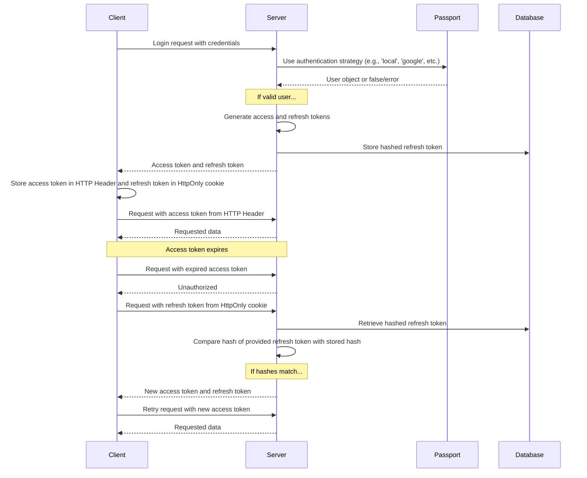

What users see when they sign up and sign in is described on the [Authentication](/docs/features/authentication) feature page. Provider-specific setup lives in the [OAuth2 and OpenID Connect](/docs/configuration/authentication/OAuth2-OIDC), [SAML](/docs/configuration/authentication/SAML), [LDAP](/docs/configuration/authentication/ldap), [email](/docs/configuration/authentication/email), and [passkeys](/docs/configuration/authentication/passkeys) guides. Allowed email domains and the order of the login buttons are set in the [`registration`](/docs/configuration/librechat_yaml/object_structure/registration) block of `librechat.yaml`.

In a single-tenant deployment, the first account registered gets the `ADMIN` role, so create it yourself before opening registration to others, and make it a local email and password account. Tenant-scoped deployments never promote their first user; provision tenant admins through a trusted administrative flow.

## 일반 [#general]

<OptionTable
  options={[
    ['ALLOW_EMAIL_LOGIN', 'boolean', 'Show the email login form and accept local or LDAP credential logins through the authentication API.','ALLOW_EMAIL_LOGIN=true'],
    ['ALLOW_EMAIL_LOGIN_OVERRIDE', 'boolean', 'Still accept email login through the API while ALLOW_EMAIL_LOGIN is false. Each use is logged. Commented out by default.','# ALLOW_EMAIL_LOGIN_OVERRIDE=false'],
    ['ALLOW_REGISTRATION', 'boolean', '새 사용자의 이메일 등록을 활성화하거나 비활성화합니다.','ALLOW_REGISTRATION=true'],
    ['ALLOW_SOCIAL_LOGIN', 'boolean', '사용자가 다양한 소셜 네트워크를 통해 LibreChat에 연결할 수 있도록 허용합니다.','ALLOW_SOCIAL_LOGIN=false'],
    ['ALLOW_SOCIAL_REGISTRATION', 'boolean', '다양한 소셜 네트워크를 사용하여 새 사용자 등록을 활성화하거나 비활성화합니다.','ALLOW_SOCIAL_REGISTRATION=false'],
    ['ALLOW_ACCOUNT_DELETION', 'boolean', 'Show the Delete account option in Settings > Account. Enabled when unset.','# ALLOW_ACCOUNT_DELETION=true'],
    ['ALLOW_EMAIL_CHANGE', 'boolean', 'Let email and password users change their email address from Settings > Account (needs email configured). Enabled when unset. emailChange in librechat.yaml takes precedence. See Email address change on the email setup page.','# ALLOW_EMAIL_CHANGE=true'],
  ]}
/>

> **참고:** OpenID 및 SAML은 등록만 비활성화하는 기능을 지원하지 않습니다.

`ALLOW_EMAIL_LOGIN=false`를 설정하면 이메일 로그인 폼이 숨겨지며 `/api/auth/login`에 대한 로컬 또는 LDAP 자격 증명 요청이 거부됩니다. OAuth, OpenID Connect 및 SAML 로그인은 영향을 받지 않습니다. `ALLOW_EMAIL_LOGIN_OVERRIDE=true`는 폼이 숨겨진 상태에서도 자격 증명 로그인이 필요한 제어된 API 통합을 위해서만 의도되었습니다. 모든 오버라이드 사용 시 요청 IP가 기록되므로 해당 경로를 주의 깊게 보호하고 모니터링하십시오.

빠른 팁:

- 등록이 비활성화된 상태에서도 아래에 자세히 설명된 [create-user 스크립트](#create-user-script)를 사용하여 데이터베이스에 사용자를 직접 추가할 수 있습니다.
- 사용자를 삭제하려면 아래에 자세히 설명된 [delete-user 스크립트](#delete-user-script)를 사용할 수 있습니다.

<ThemeImage
  light="/images/features/authentication/register-light.png"
  dark="/images/features/authentication/register-dark.png"
  alt="The Create your account registration form with Full name, Username (optional), Email, Password, and Confirm password fields"
/>

## Email verification and password reset [#email-verification-and-password-reset]

When an [email service](/docs/configuration/authentication/email) is configured, new email and password accounts get a verification link. Without one, accounts are marked verified as soon as they are created.

<OptionTable
  options={[
    ['ALLOW_UNVERIFIED_EMAIL_LOGIN', 'boolean', 'Let users sign in before verifying their email. When false, unverified users cannot sign in, and accounts that are never verified are deleted after one week.','ALLOW_UNVERIFIED_EMAIL_LOGIN=true'],
    ['ALLOW_PASSWORD_RESET', 'boolean', 'Show the Forgot Password? link and allow password resets. Reset links are valid for 15 minutes, and a successful reset ends all of the account\'s sessions. Without an email service the link is shown directly on the page to anyone who enters the address, so only enable this together with email.','ALLOW_PASSWORD_RESET=false'],
  ]}
/>

## Two-factor authentication [#two-factor-authentication]

Email and password users and LDAP users can always turn on 2FA themselves from **Settings > Account**. Accounts that sign in through OAuth, OpenID Connect, or SAML do not get the option, because their identity provider is responsible for MFA.

### Required two-factor authentication [#required-two-factor-authentication]

Set `ENFORCE_TWO_FACTOR_AUTHENTICATION=true` to make 2FA mandatory for local and LDAP accounts:

- A user without 2FA who signs in (with a password, LDAP credentials, or a passkey) gets no session until setup is done. They land on the **Two-Factor Authentication Required** screen, scan a QR code, confirm a code, and save their backup codes. The setup session lasts 10 minutes; if it expires, they start again from the login page.
- Users who are already signed in are sent into the same setup the next time their session is checked or refreshed, and access tokens issued before enrollment stop working.
- After enrollment, the **Disable 2FA** control shows **Required by administrator** and the server refuses to turn 2FA off. Users can still regenerate backup codes.
- A federated account that tries to sign in with a password while enforcement is on is told to use its identity provider.

<OptionTable
  options={[
    ['ENFORCE_TWO_FACTOR_AUTHENTICATION', 'boolean', '전체 세션이 발급되기 전에 로컬 및 LDAP 계정이 2FA에 등록하도록 요구합니다. 기본값: false.','ENFORCE_TWO_FACTOR_AUTHENTICATION=false'],
    ['TWO_FACTOR_BACKUP_CODE_FORMAT', 'string', 'Format of newly issued backup codes: strong (default) or legacy. See Backup-code compatibility below.','# TWO_FACTOR_BACKUP_CODE_FORMAT=strong'],
  ]}
/>

`ENFORCE_TWO_FACTOR_AUTHENTICATION` and the 2FA attempt limits are process-wide environment settings. They apply before any request or tenant configuration is available, so they cannot be set in `librechat.yaml` or per tenant; set the same values on every replica. The code-attempt limits (`TWO_FACTOR_TEMP_*`, `TWO_FACTOR_SETUP_*`) are on the [Automated Moderation](/docs/configuration/mod_system#two-factor-and-passkey-rate-limiting) page. The separate budget for managing 2FA from Settings is [`rateLimits.twoFactorManagement`](/docs/configuration/librechat_yaml/object_structure/config#ratelimits) in `librechat.yaml`.

## Passkeys [#passkeys]

Passkeys (WebAuthn) let users sign in with a device screen lock or a security key. They are off by default; turn them on with `ALLOW_PASSKEY_LOGIN=true`. The relying party settings, per-user limit, and rate limits are on the [Passkeys](/docs/configuration/authentication/passkeys) page.

## 세션 만료 및 리프레시 토큰 [#session-expiry-and-refresh-token]

`SESSION_EXPIRY` is how long an access token lasts (15 minutes by default); it is renewed automatically in the background. `REFRESH_TOKEN_EXPIRY` is how long a user stays signed in (7 days by default). Each renewal issues a new refresh token tied to the same session and its original expiry, so the window counts from login and activity does not extend it. If users are signed out sooner than you want, raise `REFRESH_TOKEN_EXPIRY`.

With [`OPENID_REUSE_TOKENS=true`](/docs/configuration/authentication/OAuth2-OIDC/token-reuse), the session cookie holds the identity provider's refresh token instead, so the provider's lifetime, rotation, and revocation policy decide when the session ends; `REFRESH_TOKEN_EXPIRY` cannot extend an expired or revoked IdP token.

<OptionTable
  options={[
    ['SESSION_EXPIRY', 'integer (milliseconds)', '세션 만료 시간.','SESSION_EXPIRY=1000 * 60 * 15'],
    ['REFRESH_TOKEN_EXPIRY', 'integer (milliseconds)', '리프레시 토큰 만료 시간.','REFRESH_TOKEN_EXPIRY=(1000 * 60 * 60 * 24) * 7'],
    ['SESSION_COOKIE_SECURE', 'boolean', 'Force the Secure attribute on session and auth cookies on (true) or off (false). Leave unset to decide from NODE_ENV and DOMAIN_SERVER. Set false only for plain HTTP deployments where browsers drop Secure cookies.','# SESSION_COOKIE_SECURE=false'],
  ]}
/>



## JWT Secret 및 Refresh Secret [#jwt-secret-and-refresh-secret]

- If these are left blank, LibreChat generates temporary secrets in `.env.temp`. Set your own persistent values before running a production instance. The examples given are 32-byte keys (64 characters in hex).
  - Use this tool to generate some quickly: **[JWT Keys](/toolkit/creds_generator)**

<OptionTable
  options={[
    ['JWT_SECRET', 'string (hex)', 'JWT 비밀 키.','JWT_SECRET='],
    ['JWT_REFRESH_SECRET', 'string (hex)', 'JWT 리프레시 비밀 키.','JWT_REFRESH_SECRET='],
  ]}
/>

Use unique values of at least 32 bytes, store them securely, and give every LibreChat replica the same values. When either value is blank, LibreChat can generate and reuse a value from its temporary credentials file. The default Docker Compose stacks persist that file, but this is intended only as a bootstrap convenience. If the file is lost or cannot be written, sessions can become invalid after restart. See [Credentials Configuration](/docs/configuration/dotenv#credentials-configuration) for precedence, persistence, and production guidance.

---

## Automated Moderation [#automated-moderation]

Login, registration, password reset, and 2FA attempts are rate limited, and repeated violations lead to temporary bans. See [Automated Moderation](/docs/configuration/mod_system).

## 사용자 관리 스크립트 [#user-management-scripts]

### 사용자 스크립트 생성 [#create-user-script]

Use the create-user script to add users directly to the database, even when registration is disabled:

1. 기본 `docker-compose.yml`의 경우 (앱을 시작하기 위해 `docker compose up`을 사용하는 경우):
   ```bash
   docker compose exec api npm run create-user
   ```

2. `deploy-compose.yml`의 경우 ([Ubuntu Docker 가이드](/docs/remote/docker_linux)를 따랐다면):
   ```bash
   docker exec -it LibreChat-API /bin/sh -c "cd .. && npm run create-user"
   ```

3. 로컬 개발을 위해 (프로젝트 루트에서):
   ```bash
   npm run create-user
   ```

프롬프트에 따라 새 사용자의 이메일과 비밀번호를 입력하세요.

### 사용자 삭제 스크립트 [#delete-user-script]

사용자를 삭제하려면 delete-user 스크립트를 사용할 수 있습니다:

1. 기본 `docker-compose.yml`의 경우 (앱을 시작하기 위해 `docker compose up`을 사용하는 경우):
   ```bash
   docker compose exec api npm run delete-user email@domain.com
   ```

2. `deploy-compose.yml`의 경우 ([Ubuntu Docker 가이드](/docs/remote/docker_linux)를 따랐다면):
   ```bash
   docker exec -it LibreChat-API /bin/sh -c "cd .. && npm run delete-user email@domain.com"
   ```

3. 로컬 개발을 위해 (프로젝트 루트에서):
   ```bash
   npm run delete-user email@domain.com
   ```

`email@domain.com`을 삭제하려는 사용자의 이메일 주소로 바꾸세요.

## Backup-code compatibility [#backup-code-compatibility]

새로 생성되거나 재생성된 백업 코드는 기본적으로 128비트 무작위 값이며, 각 코드마다 개별적으로 솔트를 적용한 해시로 저장됩니다. 기존 레거시 코드는 재생성될 때까지 계속 사용할 수 있습니다. `TWO_FACTOR_BACKUP_CODE_FORMAT=legacy`를 설정하면 이전 방식인 32비트 무솔트 형식의 코드가 일시적으로 발급됩니다. 호환되지 않는 백엔드나 클라이언트가 남아 있는 동안에는 모든 레플리카에 이 설정을 적용하고, 이후 제거하십시오. 강력한 코드를 발급한 뒤에는 해당 코드를 교체하지 않은 채로 호환되지 않는 백엔드로 롤백하지 마십시오. 자세한 내용은 [롤링 배포 가이드](/docs/configuration/upgrade#mixed-version-compatibility)를 참조하십시오.
