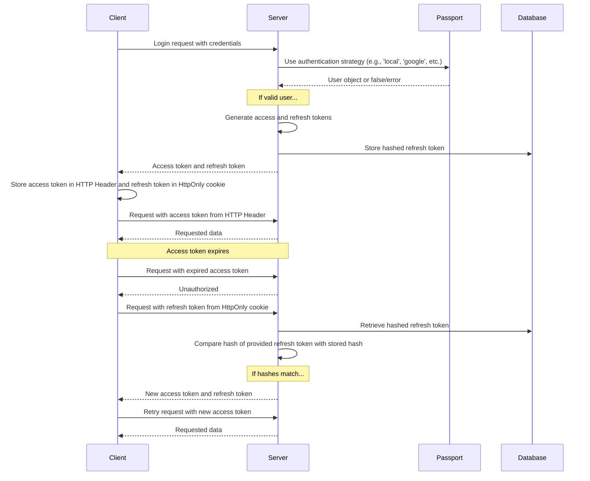

O que os usuários veem ao se cadastrar e entrar está descrito na página de recurso [Autenticação](/docs/features/authentication). A configuração específica de cada provedor está nos guias [OAuth2 e OpenID Connect](/docs/configuration/authentication/OAuth2-OIDC), [SAML](/docs/configuration/authentication/SAML), [LDAP](/docs/configuration/authentication/ldap), [e-mail](/docs/configuration/authentication/email) e [passkeys](/docs/configuration/authentication/passkeys). Os domínios de e-mail permitidos e a ordem dos botões de login são definidos no bloco [`registration`](/docs/configuration/librechat_yaml/object_structure/registration) de `librechat.yaml`.

Em uma implantação de locatário único, a primeira conta registrada recebe a função `ADMIN`; portanto, crie-a você mesmo antes de abrir o registro para outras pessoas, e faça dela uma conta local com e-mail e senha. Implantações com escopo de locatário nunca promovem o primeiro usuário; provisione os administradores de locatário por meio de um fluxo administrativo confiável.

## Geral [#general]

<OptionTable
  options={[
    ['ALLOW_EMAIL_LOGIN', 'boolean', 'Exibir o formulário de login por e-mail e aceitar logins com credenciais locais ou LDAP por meio da API de autenticação.','ALLOW_EMAIL_LOGIN=true'],
    ['ALLOW_EMAIL_LOGIN_OVERRIDE', 'boolean', 'Continue aceitando login por e-mail pela API enquanto ALLOW_EMAIL_LOGIN estiver como false. Cada uso é registrado em log. Comentado por padrão.','# ALLOW_EMAIL_LOGIN_OVERRIDE=false'],
    ['ALLOW_REGISTRATION', 'boolean', 'Habilitar ou desabilitar o registro de novos usuários por e-mail.','ALLOW_REGISTRATION=true'],
    ['ALLOW_SOCIAL_LOGIN', 'boolean', 'Permitir que usuários se conectem ao LibreChat com várias redes sociais.','ALLOW_SOCIAL_LOGIN=false'],
    ['ALLOW_SOCIAL_REGISTRATION', 'boolean', 'Habilite ou desabilite o registro de novos usuários usando várias redes sociais.','ALLOW_SOCIAL_REGISTRATION=false'],
    ['ALLOW_ACCOUNT_DELETION', 'boolean', 'Exibir a opção Excluir conta em Configurações > Conta. Habilitada quando não definida.','# ALLOW_ACCOUNT_DELETION=true'],
    ['ALLOW_EMAIL_CHANGE', 'boolean', 'Permitir que usuários com e-mail e senha alterem seu endereço de e-mail em Configurações > Conta (requer e-mail configurado). Habilitado quando não definido. emailChange no librechat.yaml tem precedência. Consulte Alteração de endereço de e-mail na página de configuração de e-mail.','# ALLOW_EMAIL_CHANGE=true'],
  ]}
/>

> **Nota:** OpenID e SAML não oferecem suporte à capacidade de desabilitar apenas o registro.

Definir `ALLOW_EMAIL_LOGIN=false` oculta o formulário de login por e-mail e rejeita solicitações de credenciais locais ou LDAP para `/api/auth/login`; o login via OAuth, OpenID Connect e SAML não é afetado. `ALLOW_EMAIL_LOGIN_OVERRIDE=true` destina-se apenas a uma integração de API controlada que ainda precisa de login por credenciais enquanto o formulário está oculto. Cada uso do override registra o IP da solicitação, portanto, proteja e monitore essa rota cuidadosamente.

Dicas Rápidas:

- Mesmo com o registro desativado, você pode adicionar usuários diretamente ao banco de dados usando [o script create-user](#create-user-script) detalhado abaixo.
- Para excluir um usuário, você pode usar [o script delete-user](#delete-user-script), também detalhado abaixo.

<ThemeImage
  light="/images/features/authentication/register-light.png"
  dark="/images/features/authentication/register-dark.png"
  alt="Crie sua conta: formulário de registro com os campos Nome completo, Nome de usuário (opcional), E-mail, Senha e Confirmar senha"
/>

## Verificação de e-mail e redefinição de senha [#email-verification-and-password-reset]

Quando um [serviço de e-mail](/docs/configuration/authentication/email) está configurado, novas contas de e-mail e senha recebem um link de verificação. Sem um, as contas são marcadas como verificadas assim que são criadas.

<OptionTable
  options={[
    ['ALLOW_UNVERIFIED_EMAIL_LOGIN', 'boolean', 'Permitir que usuários façam login antes de verificar o e-mail. Quando definido como false, usuários não verificados não podem fazer login, e contas que nunca são verificadas são excluídas após uma semana.','ALLOW_UNVERIFIED_EMAIL_LOGIN=true'],
    ['ALLOW_PASSWORD_RESET', 'boolean', 'Exibe o link "Esqueceu a senha?" e permite redefinir senhas. Os links de redefinição são válidos por 15 minutos, e uma redefinição bem-sucedida encerra todas as sessões da conta. Sem um serviço de e-mail, o link é exibido diretamente na página para qualquer pessoa que informe o endereço, por isso só ative esta opção junto com o e-mail.','ALLOW_PASSWORD_RESET=false'],
  ]}
/>

## Autenticação de dois fatores [#two-factor-authentication]

Usuários com e-mail e senha e usuários LDAP sempre podem ativar a autenticação em dois fatores (2FA) por conta própria, em **Configurações > Conta**. Contas que fazem login por OAuth, OpenID Connect ou SAML não têm essa opção, pois o provedor de identidade é responsável pela autenticação multifator (MFA).

### Autenticação de dois fatores obrigatória [#required-two-factor-authentication]

Defina `ENFORCE_TWO_FACTOR_AUTHENTICATION=true` para tornar a 2FA obrigatória para contas locais e LDAP:

- Um usuário sem 2FA que faz login (com senha, credenciais LDAP ou uma passkey) não recebe uma sessão até que a configuração seja concluída. Ele é direcionado para a tela **Autenticação de Dois Fatores Obrigatória**, escaneia um QR code, confirma um código e salva seus códigos de backup. A sessão de configuração dura 10 minutos; se expirar, ele precisa começar novamente pela página de login.
- Usuários que já estão autenticados são direcionados para a mesma configuração na próxima vez que sua sessão for verificada ou atualizada, e os tokens de acesso emitidos antes da inscrição deixam de funcionar.
- Após a inscrição, o controle **Disable 2FA** exibe **Required by administrator** e o servidor recusa desativar o 2FA. Os usuários ainda podem gerar novamente os códigos de backup.
- Uma conta federada que tenta fazer login com senha enquanto a aplicação está ativa é orientada a usar o seu provedor de identidade.

<OptionTable
  options={[
    ['ENFORCE_TWO_FACTOR_AUTHENTICATION', 'boolean', 'Exigir que contas locais e LDAP se inscrevam na 2FA antes que uma sessão completa seja emitida. Padrão: false.','ENFORCE_TWO_FACTOR_AUTHENTICATION=false'],
    ['TWO_FACTOR_BACKUP_CODE_FORMAT', 'string', 'Formato dos novos códigos de backup: strong (padrão) ou legacy. Veja Compatibilidade de códigos de backup abaixo.','# TWO_FACTOR_BACKUP_CODE_FORMAT=strong'],
  ]}
/>

`ENFORCE_TWO_FACTOR_AUTHENTICATION` e os limites de tentativas de 2FA são configurações de ambiente de todo o processo. Elas se aplicam antes de qualquer requisição ou configuração de tenant estar disponível, por isso não podem ser definidas no `librechat.yaml` nem por tenant; defina os mesmos valores em todas as réplicas. Os limites de tentativas de código (`TWO_FACTOR_TEMP_*`, `TWO_FACTOR_SETUP_*`) estão descritos na página [Automated Moderation](/docs/configuration/mod_system#two-factor-and-passkey-rate-limiting). O orçamento separado para gerenciar o 2FA a partir das Configurações é [`rateLimits.twoFactorManagement`](/docs/configuration/librechat_yaml/object_structure/config#ratelimits) no `librechat.yaml`.

## Passkeys [#passkeys]

As chaves de acesso (WebAuthn) permitem que os usuários façam login com o bloqueio de tela do dispositivo ou com uma chave de segurança. Elas vêm desativadas por padrão; para ativá-las, defina `ALLOW_PASSKEY_LOGIN=true`. As configurações da parte confiável (relying party), o limite por usuário e os limites de taxa estão na página [Passkeys](/docs/configuration/authentication/passkeys).

## Expiração de Sessão e Token de Atualização [#session-expiry-and-refresh-token]

`SESSION_EXPIRY` é a duração de um token de acesso (15 minutos por padrão); ele é renovado automaticamente em segundo plano. `REFRESH_TOKEN_EXPIRY` é o tempo que um usuário permanece conectado (7 dias por padrão). Cada renovação emite um novo token de atualização vinculado à mesma sessão e à sua data de expiração original, portanto a janela é contada a partir do login e a atividade não a estende. Se os usuários estiverem sendo desconectados antes do desejado, aumente `REFRESH_TOKEN_EXPIRY`.

Com [`OPENID_REUSE_TOKENS=true`](/docs/configuration/authentication/OAuth2-OIDC/token-reuse), o cookie de sessão passa a armazenar o refresh token do provedor de identidade, de modo que a duração, a rotação e a política de revogação do provedor determinam quando a sessão termina; `REFRESH_TOKEN_EXPIRY` não pode estender um token do IdP que tenha expirado ou sido revogado.

<OptionTable
  options={[
    ['SESSION_EXPIRY', 'integer (milliseconds)', 'Tempo de expiração da sessão.','SESSION_EXPIRY=1000 * 60 * 15'],
    ['REFRESH_TOKEN_EXPIRY', 'integer (milliseconds)', 'Tempo de expiração do token de atualização.','REFRESH_TOKEN_EXPIRY=(1000 * 60 * 60 * 24) * 7'],
    ['SESSION_COOKIE_SECURE', 'boolean', 'Force o atributo Secure nos cookies de sessão e autenticação como ativado (true) ou desativado (false). Deixe sem definir para decidir com base em NODE_ENV e DOMAIN_SERVER. Defina como false apenas em implantações HTTP simples, onde os navegadores descartam cookies Secure.','# SESSION_COOKIE_SECURE=false'],
  ]}
/>



## JWT Secret e Refresh Secret [#jwt-secret-and-refresh-secret]

- Se estes campos forem deixados em branco, o LibreChat gera segredos temporários em `.env.temp`. Defina seus próprios valores persistentes antes de executar uma instância de produção. Os exemplos fornecidos são chaves de 32 bytes (64 caracteres em hexadecimal).
  - Use esta ferramenta para gerar algumas rapidamente: **[Chaves JWT](/toolkit/creds_generator)**

<OptionTable
  options={[
    ['JWT_SECRET', 'string (hex)', 'Chave secreta JWT.','JWT_SECRET='],
    ['JWT_REFRESH_SECRET', 'string (hex)', 'Chave secreta de atualização JWT.','JWT_REFRESH_SECRET='],
  ]}
/>

Use valores exclusivos de pelo menos 32 bytes, armazene-os com segurança e forneça os mesmos valores a todas as réplicas do LibreChat. Quando qualquer um desses valores estiver em branco, o LibreChat pode gerar e reutilizar um valor a partir do seu arquivo de credenciais temporárias. As stacks padrão do Docker Compose persistem esse arquivo, mas isso se destina apenas como uma conveniência para inicialização. Se o arquivo for perdido ou não puder ser gravado, as sessões podem se tornar inválidas após a reinicialização. Consulte [Credentials Configuration](/docs/configuration/dotenv#credentials-configuration) para ver a precedência, a persistência e as orientações para produção.

---

## Moderação Automatizada [#automated-moderation]

Tentativas de login, registro, redefinição de senha e autenticação em dois fatores (2FA) têm limite de taxa, e violações repetidas resultam em banimentos temporários. Consulte [Moderação Automatizada](/docs/configuration/mod_system).

## Scripts de Gerenciamento de Usuários [#user-management-scripts]

### Criar Script de Usuário [#create-user-script]

Use o script create-user para adicionar usuários diretamente ao banco de dados, mesmo quando o registro estiver desabilitado:

1. Para o `docker-compose.yml` padrão (se você usar `docker compose up` para iniciar o aplicativo):
   ```bash
   docker compose exec api npm run create-user
   ```

2. Para o `deploy-compose.yml` (se você seguiu o [Guia do Docker no Ubuntu](/docs/remote/docker_linux)):
   ```bash
   docker exec -it LibreChat-API /bin/sh -c "cd .. && npm run create-user"
   ```

3. Para desenvolvimento local (a partir da raiz do projeto):
   ```bash
   npm run create-user
   ```

Siga as instruções para inserir o e-mail e a senha do novo usuário.

### Script para Excluir Usuário [#delete-user-script]

Para excluir um usuário, você pode usar o script delete-user:

1. Para o `docker-compose.yml` padrão (se você usar `docker compose up` para iniciar o aplicativo):
   ```bash
   docker compose exec api npm run delete-user email@domain.com
   ```

2. Para o `deploy-compose.yml` (se você seguiu o [Guia do Docker no Ubuntu](/docs/remote/docker_linux)):
   ```bash
   docker exec -it LibreChat-API /bin/sh -c "cd .. && npm run delete-user email@domain.com"
   ```

3. Para desenvolvimento local (a partir da raiz do projeto):
   ```bash
   npm run delete-user email@domain.com
   ```

Substitua `email@domain.com` pelo e-mail do usuário que você deseja excluir.

## Compatibilidade de códigos de backup [#backup-code-compatibility]

Novos códigos de backup e códigos regenerados têm, por padrão, valores aleatórios de 128 bits com hashes individualmente salteados. Os códigos legados existentes continuam utilizáveis até serem regenerados. `TWO_FACTOR_BACKUP_CODE_FORMAT=legacy` emite temporariamente o formato anterior de 32 bits, sem salt. Aplique-o em todas as réplicas enquanto houver backends ou clientes incompatíveis e, em seguida, remova-o. Não faça rollback para um backend incompatível depois de emitir códigos fortes sem substituí-los. Consulte o [guia de implantação gradual](/docs/configuration/upgrade#mixed-version-compatibility).
