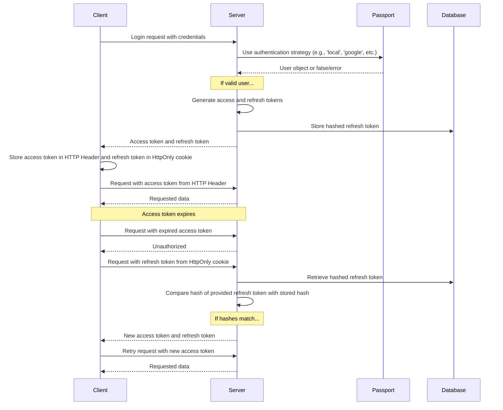

Kullanıcıların kayıt olurken ve oturum açarken ne gördüğü, [Kimlik Doğrulama](/docs/features/authentication) özellik sayfasında açıklanmaktadır. Sağlayıcıya özgü kurulum ayrıntıları ise [OAuth2 ve OpenID Connect](/docs/configuration/authentication/OAuth2-OIDC), [SAML](/docs/configuration/authentication/SAML), [LDAP](/docs/configuration/authentication/ldap), [e-posta](/docs/configuration/authentication/email) ve [parolasız giriş anahtarları (passkeys)](/docs/configuration/authentication/passkeys) kılavuzlarında yer almaktadır. İzin verilen e-posta alan adları ve oturum açma düğmelerinin sırası ise `librechat.yaml` dosyasındaki [`registration`](/docs/configuration/librechat_yaml/object_structure/registration) bloğunda ayarlanır.

Tek kiracılı (single-tenant) bir dağıtımda, kaydedilen ilk hesap `ADMIN` rolünü alır. Bu nedenle kayıtları başkalarına açmadan önce bu hesabı kendiniz oluşturun ve yerel bir e-posta ve parola hesabı olarak tanımlayın. Kiracıya özgü (tenant-scoped) dağıtımlarda ilk kullanıcı asla yükseltilmez; kiracı yöneticilerini güvenilir bir yönetim akışı üzerinden sağlayın.

## Genel [#general]

<OptionTable
  options={[
    ['ALLOW_EMAIL_LOGIN', 'boolean', 'E-posta giriş formunu göster ve kimlik doğrulama API\'si aracılığıyla yerel veya LDAP kimlik bilgisi girişlerini kabul et.','ALLOW_EMAIL_LOGIN=true'],
    ['ALLOW_EMAIL_LOGIN_OVERRIDE', 'boolean', 'API üzerinden e-posta ile giriş, ALLOW_EMAIL_LOGIN false olsa bile kabul edilmeye devam eder. Her kullanım kaydedilir. Varsayılan olarak yorum satırı içindedir.','# ALLOW_EMAIL_LOGIN_OVERRIDE=false'],
    ['ALLOW_REGISTRATION', 'boolean', 'Yeni kullanıcıların E-posta ile kaydını etkinleştirin veya devre dışı bırakın.','ALLOW_REGISTRATION=true'],
    ['ALLOW_SOCIAL_LOGIN', 'boolean', 'Kullanıcıların LibreChat\'e çeşitli sosyal ağlarla bağlanmasına izin verin.','ALLOW_SOCIAL_LOGIN=false'],
    ['ALLOW_SOCIAL_REGISTRATION', 'boolean', 'Çeşitli sosyal ağları kullanarak yeni kullanıcıların kaydını etkinleştirin veya devre dışı bırakın.','ALLOW_SOCIAL_REGISTRATION=false'],
    ['ALLOW_ACCOUNT_DELETION', 'boolean', 'Ayarlar > Hesap bölümünde Hesabı sil seçeneğini göster. Ayarlanmadığında etkindir.','# ALLOW_ACCOUNT_DELETION=true'],
    ['ALLOW_EMAIL_CHANGE', 'boolean', 'E-posta ve şifre kullanıcıları, Ayarlar > Hesap bölümünden e-posta adreslerini değiştirebilir (e-posta yapılandırılmış olmalıdır). Ayarlanmadığında etkindir. librechat.yaml içindeki emailChange ayarı önceliklidir. Bkz. e-posta kurulum sayfasındaki E-posta adresi değişikliği.','# ALLOW_EMAIL_CHANGE=true'],
  ]}
/>

> **Not:** OpenID ve SAML, yalnızca kaydı devre dışı bırakma özelliğini desteklemez.

`ALLOW_EMAIL_LOGIN=false` ayarını yapmak, e-posta giriş formunu gizler ve `/api/auth/login` adresine yapılan yerel veya LDAP kimlik bilgisi isteklerini reddeder; OAuth, OpenID Connect ve SAML ile giriş işlemleri bundan etkilenmez. `ALLOW_EMAIL_LOGIN_OVERRIDE=true` ayarı, yalnızca form gizliyken kimlik bilgisi ile girişe ihtiyaç duyan kontrollü bir API entegrasyonu için tasarlanmıştır. Her geçersiz kılma (override) kullanımı istek IP'sini günlüğe kaydeder, bu nedenle bu rotayı dikkatlice koruyun ve izleyin.

Hızlı İpuçları:

- Kayıt özelliği devre dışı bırakılmış olsa bile, aşağıda detaylandırılan [create-user script](#create-user-script) kullanarak kullanıcıları doğrudan veritabanına ekleyebilirsiniz.
- Bir kullanıcıyı silmek için aşağıda da detaylandırılan [delete-user script](#delete-user-script) aracını kullanabilirsiniz.

<ThemeImage
  light="/images/features/authentication/register-light.png"
  dark="/images/features/authentication/register-dark.png"
  alt="Full name, Username (isteğe bağlı), Email, Password ve Confirm password alanlarını içeren Create your account kayıt formu"
/>

## E-posta doğrulama ve parola sıfırlama [#email-verification-and-password-reset]

Bir [e-posta hizmeti](/docs/configuration/authentication/email) yapılandırıldığında, yeni e-posta ve parola hesaplarına bir doğrulama bağlantısı gönderilir. Yapılandırılmadığında ise hesaplar oluşturulduğu anda doğrulanmış olarak işaretlenir.

<OptionTable
  options={[
    ['ALLOW_UNVERIFIED_EMAIL_LOGIN', 'boolean', 'Kullanıcıların e-postalarını doğrulamadan önce oturum açmasına izin verin. False olarak ayarlandığında, doğrulanmamış kullanıcılar oturum açamaz ve hiçbir zaman doğrulanmayan hesaplar bir hafta sonra silinir.','ALLOW_UNVERIFIED_EMAIL_LOGIN=true'],
    ['ALLOW_PASSWORD_RESET', 'boolean', '"Forgot Password?" bağlantısını göster ve parola sıfırlamaya izin ver. Sıfırlama bağlantıları 15 dakika boyunca geçerlidir ve başarılı bir sıfırlama, hesabın tüm oturumlarını sonlandırır. E-posta hizmeti olmadan, adresi giren herkese bağlantı doğrudan sayfada gösterilir; bu nedenle bu özelliği yalnızca e-posta ile birlikte etkinleştirin.','ALLOW_PASSWORD_RESET=false'],
  ]}
/>

## İki faktörlü kimlik doğrulama [#two-factor-authentication]

E-posta ve şifre kullanıcıları ile LDAP kullanıcıları, **Ayarlar > Hesap** bölümünden istedikleri zaman kendi kendilerine 2FA'yı etkinleştirebilirler. OAuth, OpenID Connect veya SAML ile oturum açan hesaplarda bu seçenek bulunmaz, çünkü MFA'dan kimlik sağlayıcıları sorumludur.

### Gerekli iki faktörlü kimlik doğrulama [#required-two-factor-authentication]

`ENFORCE_TWO_FACTOR_AUTHENTICATION=true` değerini ayarlayarak yerel ve LDAP hesapları için 2FA'yı zorunlu hale getirin:

- Two-Factor Authentication olmayan bir kullanıcı oturum açtığında (parola, LDAP kimlik bilgileri veya bir geçiş anahtarı ile) kurulum tamamlanana kadar oturum oluşturulmaz. Kullanıcı **Two-Factor Authentication Required** (İki Faktörlü Kimlik Doğrulama Gerekli) ekranına yönlendirilir, bir QR kodu tarar, bir kodu onaylar ve yedek kodlarını kaydeder. Kurulum oturumu 10 dakika geçerlidir; süresi dolarsa kullanıcı oturum açma sayfasından yeniden başlamalıdır.
- Oturum açmış kullanıcılar, oturumları bir sonraki kontrol edildiğinde veya yenilendiğinde aynı kurulum sürecine yönlendirilir ve kayıt olmadan önce verilmiş erişim belirteçleri artık çalışmaz.
- Kayıt işleminden sonra **2FA'yı Devre Dışı Bırak** kontrolü **Yönetici tarafından gerekli** ifadesini gösterir ve sunucu 2FA'yı kapatmayı reddeder. Kullanıcılar yine de yedek kodlarını yeniden oluşturabilir.
- Kimlik birleştirme kullanan ve zorunlu kılma etkinken parola ile oturum açmaya çalışan bir hesap, kimlik sağlayıcısını kullanması gerektiği konusunda bilgilendirilir.

<OptionTable
  options={[
    ['ENFORCE_TWO_FACTOR_AUTHENTICATION', 'boolean', 'Tam bir oturum başlatılmadan önce yerel ve LDAP hesaplarının 2FA kaydı yapmasını zorunlu tutar. Varsayılan: false.','ENFORCE_TWO_FACTOR_AUTHENTICATION=false'],
    ['TWO_FACTOR_BACKUP_CODE_FORMAT', 'string', 'Yeni verilen yedek kodların biçimi: strong (varsayılan) veya legacy. Aşağıdaki Yedek kod uyumluluğu bölümüne bakın.','# TWO_FACTOR_BACKUP_CODE_FORMAT=strong'],
  ]}
/>

`ENFORCE_TWO_FACTOR_AUTHENTICATION` ve 2FA deneme sınırları, süreç genelinde geçerli ortam ayarlarıdır. Herhangi bir istek veya kiracı yapılandırması kullanılabilir hale gelmeden önce uygulanırlar; bu nedenle `librechat.yaml` içinde veya kiracı bazında ayarlanamazlar. Aynı değerleri her replica üzerinde ayarlayın. Kod deneme sınırları (`TWO_FACTOR_TEMP_*`, `TWO_FACTOR_SETUP_*`) [Otomatik Moderasyon](/docs/configuration/mod_system#two-factor-and-passkey-rate-limiting) sayfasında yer almaktadır. Ayarlar üzerinden 2FA yönetimi için ayrılmış ayrı bütçe ise `librechat.yaml` dosyasındaki [`rateLimits.twoFactorManagement`](/docs/configuration/librechat_yaml/object_structure/config#ratelimits) alanıdır.

## Passkeys [#passkeys]

Passkey'ler (WebAuthn), kullanıcıların bir cihazın ekran kilidi veya bir güvenlik anahtarı ile oturum açmasına olanak tanır. Varsayılan olarak kapalıdır; `ALLOW_PASSKEY_LOGIN=true` ile açabilirsiniz. Relying party ayarları, kullanıcı başına limit ve hız sınırları [Passkey'ler](/docs/configuration/authentication/passkeys) sayfasında yer almaktadır.

## Oturum Zaman Aşımı ve Yenileme Belirteci [#session-expiry-and-refresh-token]

`SESSION_EXPIRY`, bir erişim belirtecinin (access token) ne kadar süre geçerli kalacağını belirtir (varsayılan olarak 15 dakika); bu süre sonunda belirteç arka planda otomatik olarak yenilenir. `REFRESH_TOKEN_EXPIRY` ise bir kullanıcının ne kadar süre oturum açık kalacağını belirtir (varsayılan olarak 7 gün). Her yenilemede, aynı oturuma ve orijinal son kullanma tarihine bağlı yeni bir yenileme belirteci (refresh token) düzenlenir; bu nedenle süre oturum açma anından itibaren sayılır ve kullanıcı etkinliği bu süreyi uzatmaz. Kullanıcıların oturumu beklediğinizden daha erken kapanıyorsa, `REFRESH_TOKEN_EXPIRY` değerini artırın.

[`OPENID_REUSE_TOKENS=true`](/docs/configuration/authentication/OAuth2-OIDC/token-reuse) ile oturum çerezi bunun yerine kimlik sağlayıcısının yenileme jetonunu (refresh token) tutar; bu nedenle oturumun ne zaman sona ereceğine sağlayıcının geçerlilik süresi, yenileme (rotation) ve iptal (revocation) politikası karar verir. `REFRESH_TOKEN_EXPIRY` süresi dolmuş veya iptal edilmiş bir IdP jetonunun süresini uzatamaz.

<OptionTable
  options={[
    ['SESSION_EXPIRY', 'integer (milliseconds)', 'Oturum zaman aşımı süresi.','SESSION_EXPIRY=1000 * 60 * 15'],
    ['REFRESH_TOKEN_EXPIRY', 'integer (milliseconds)', 'Yenileme belirteci (refresh token) sona erme süresi.','REFRESH_TOKEN_EXPIRY=(1000 * 60 * 60 * 24) * 7'],
    ['SESSION_COOKIE_SECURE', 'boolean', 'Oturum ve kimlik doğrulama çerezlerindeki Secure özniteliğini açık (true) ya da kapalı (false) olarak zorla. Belirtilmezse NODE_ENV ve DOMAIN_SERVER değerlerine göre karar verilir. Yalnızca tarayıcıların Secure çerezleri reddettiği düz HTTP dağıtımlarında false olarak ayarla.','# SESSION_COOKIE_SECURE=false'],
  ]}
/>



## JWT Secret ve Refresh Secret [#jwt-secret-and-refresh-secret]

- Bu değerler boş bırakılırsa LibreChat, `.env.temp` dosyasında geçici gizli anahtarlar oluşturur. Üretim ortamında bir örnek çalıştırmadan önce kendi kalıcı değerlerinizi ayarlayın. Verilen örnekler 32 baytlık anahtarlardır (onaltılık biçimde 64 karakter).
  - Bunu hızlıca oluşturmak için bu aracı kullanın: **[JWT Anahtarları](/toolkit/creds_generator)**

<OptionTable
  options={[
    ['JWT_SECRET', 'string (hex)', 'JWT gizli anahtarı.','JWT_SECRET='],
    ['JWT_REFRESH_SECRET', 'string (hex)', 'JWT yenileme gizli anahtarı.','JWT_REFRESH_SECRET='],
  ]}
/>

Benzersiz ve en az 32 bayt uzunluğunda değerler kullanın, bunları güvenli bir şekilde saklayın ve her LibreChat replikasına aynı değerleri verin. Herhangi bir değer boş olduğunda, LibreChat geçici kimlik bilgileri dosyasından bir değer üretebilir ve yeniden kullanabilir. Varsayılan Docker Compose yığınları bu dosyayı kalıcı hale getirir; ancak bu yalnızca bir başlatma kolaylığı olarak tasarlanmıştır. Dosya kaybolursa veya yazılamazsa, yeniden başlatmadan sonra oturumlar geçersiz hale gelebilir. Öncelik sırası, kalıcılık ve üretim ortamı için yönergeler hakkında bilgi edinmek üzere bkz. [Credentials Configuration](/docs/configuration/dotenv#credentials-configuration).

---

## Otomatik Moderasyon [#automated-moderation]

Giriş, kayıt, şifre sıfırlama ve 2FA denemeleri hız sınırlamasına tabidir ve tekrarlanan ihlaller geçici yasaklara yol açar. Bkz. [Otomatik Moderasyon](/docs/configuration/mod_system).

## Kullanıcı Yönetim Betikleri [#user-management-scripts]

### Kullanıcı Betiği Oluştur [#create-user-script]

Kayıt devre dışı bırakılmış olsa bile, kullanıcıları doğrudan veritabanına eklemek için create-user betiğini kullanın:

1. Varsayılan `docker-compose.yml` için (uygulamayı başlatmak üzere `docker compose up` kullanıyorsanız):
   ```bash
   docker compose exec api npm run create-user
   ```

2. `deploy-compose.yml` için ([Ubuntu Docker Rehberi](/docs/remote/docker_linux) kısmını takip ettiyseniz):
   ```bash
   docker exec -it LibreChat-API /bin/sh -c "cd .. && npm run create-user"
   ```

3. Yerel geliştirme için (proje kök dizininden):
   ```bash
   npm run create-user
   ```

Yeni kullanıcının e-postasını ve şifresini girmek için komutları izleyin.

### Kullanıcı Silme Betiği [#delete-user-script]

Bir kullanıcıyı silmek için delete-user betiğini kullanabilirsiniz:

1. Varsayılan `docker-compose.yml` için (uygulamayı başlatmak üzere `docker compose up` kullanıyorsanız):
   ```bash
   docker compose exec api npm run delete-user email@domain.com
   ```

2. `deploy-compose.yml` için ([Ubuntu Docker Rehberi](/docs/remote/docker_linux) kısmını takip ettiyseniz):
   ```bash
   docker exec -it LibreChat-API /bin/sh -c "cd .. && npm run delete-user email@domain.com"
   ```

3. Yerel geliştirme için (proje kök dizininden):
   ```bash
   npm run delete-user email@domain.com
   ```

`email@domain.com` ifadesini silmek istediğiniz kullanıcının e-posta adresiyle değiştirin.

## Yedek kod uyumluluğu [#backup-code-compatibility]

Yeni oluşturulan ve yeniden üretilen yedek kodlar varsayılan olarak, her biri ayrı ayrı tuzlanmış (salted) karmalarla 128 bitlik rastgele değerlerdir. Mevcut eski kodlar, yeniden oluşturulana kadar kullanılmaya devam eder. `TWO_FACTOR_BACKUP_CODE_FORMAT=legacy` ayarı, uyumsuz arka uçlar veya istemciler kullanımda kaldığı sürece, geçici olarak eski 32 bitlik, tuzlanmamış formatta kodlar üretir. Bu ayarı her kopyaya (replica) uygulayın ve ardından kaldırın. Güçlü kodlar üretildikten sonra, bunları yenilemeden uyumsuz bir arka uca geri dönmeyin. Bkz. [kademeli dağıtım rehberi](/docs/configuration/upgrade#mixed-version-compatibility).
