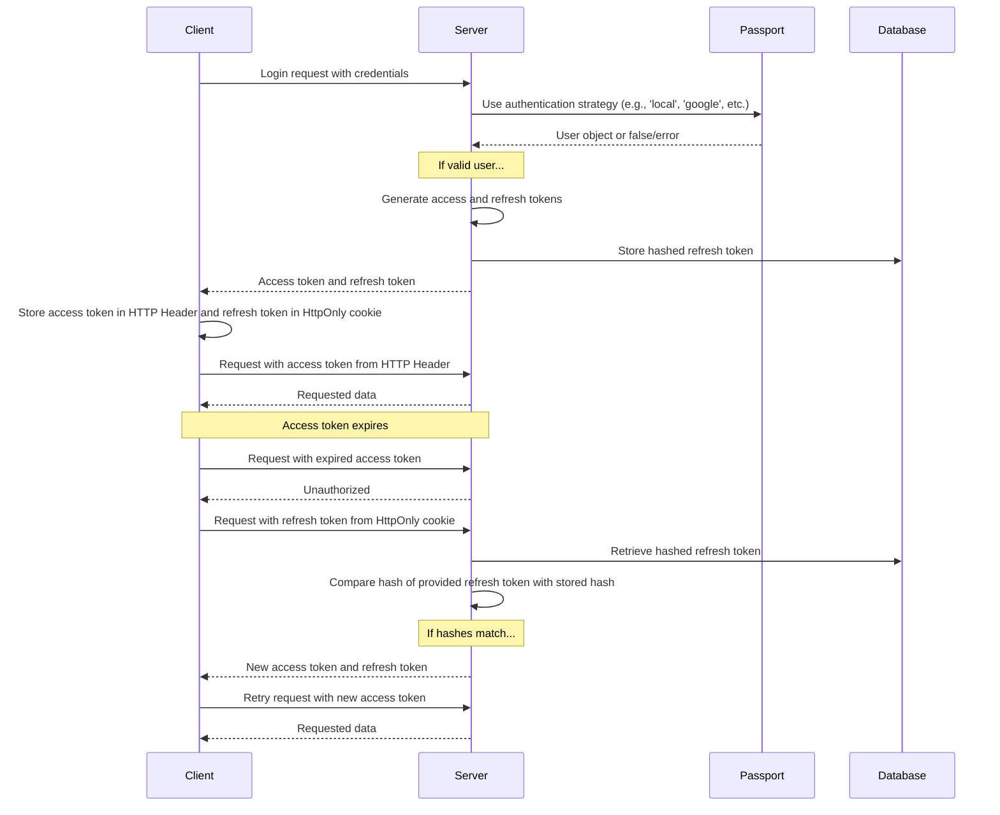

用户注册和登录时看到的界面，在[身份验证](/docs/features/authentication)功能页面中有所说明。各服务提供商的具体设置请参阅以下指南：[OAuth2 和 OpenID Connect](/docs/configuration/authentication/OAuth2-OIDC)、[SAML](/docs/configuration/authentication/SAML)、[LDAP](/docs/configuration/authentication/ldap)、[电子邮件](/docs/configuration/authentication/email)和[通行密钥](/docs/configuration/authentication/passkeys)。允许的电子邮件域名以及登录按钮的顺序，需在 `librechat.yaml` 的 [`registration`](/docs/configuration/librechat_yaml/object_structure/registration) 配置块中设置。

在单租户部署中,第一个注册的账户会获得 `ADMIN` 角色,因此请在向他人开放注册之前自行创建该账户,并将其设置为本地邮箱和密码账户。租户范围的部署从不会将其第一个用户提升为管理员;请通过受信任的管理流程来配置租户管理员。

## 常规 [#general]

<OptionTable
  options={[
    ['ALLOW_EMAIL_LOGIN', 'boolean', '显示电子邮件登录表单，并通过身份验证 API 接受本地或 LDAP 凭据登录。','ALLOW_EMAIL_LOGIN=true'],
    ['ALLOW_EMAIL_LOGIN_OVERRIDE', 'boolean', '通过 API 仍可在 ALLOW_EMAIL_LOGIN 为 false 时接受邮箱登录。每次使用都会被记录。默认情况下已被注释掉。','# ALLOW_EMAIL_LOGIN_OVERRIDE=false'],
    ['ALLOW_REGISTRATION', 'boolean', '启用或禁用新用户的电子邮件注册。','ALLOW_REGISTRATION=true'],
    ['ALLOW_SOCIAL_LOGIN', 'boolean', '允许用户通过各种社交网络连接到 LibreChat。','ALLOW_SOCIAL_LOGIN=false'],
    ['ALLOW_SOCIAL_REGISTRATION', 'boolean', '启用或禁用使用各种社交网络注册新用户的功能。','ALLOW_SOCIAL_REGISTRATION=false'],
    ['ALLOW_ACCOUNT_DELETION', 'boolean', '在“设置 > 账户”中显示“删除账户”选项。未设置时默认启用。','# ALLOW_ACCOUNT_DELETION=true'],
    ['ALLOW_EMAIL_CHANGE', 'boolean', '允许使用邮箱和密码登录的用户在「设置 > 账户」中更改邮箱地址(需要已配置邮件服务)。未设置时默认启用。librechat.yaml 中的 emailChange 配置优先生效。请参阅邮件设置页面中的「邮箱地址更改」。','# ALLOW_EMAIL_CHANGE=true'],
  ]}
/>

> **注意：** OpenID 和 SAML 不支持仅禁用注册的功能。

设置 `ALLOW_EMAIL_LOGIN=false` 将隐藏电子邮件登录表单，并拒绝发往 `/api/auth/login` 的本地或 LDAP 凭据请求；OAuth、OpenID Connect 和 SAML 登录不受影响。`ALLOW_EMAIL_LOGIN_OVERRIDE=true` 仅旨在用于在表单隐藏时仍需要凭据登录的受控 API 集成。每次使用覆盖功能都会记录请求 IP，因此请务必小心保护和监控该路由。

快速提示：

- 即使禁用了注册功能，您也可以使用下文详述的 [create-user script](#create-user-script) 将用户直接添加到数据库中。
- 要删除用户，您可以使用下文详述的 [delete-user 脚本](#delete-user-script)。

<ThemeImage
  light="/images/features/authentication/register-light.png"
  dark="/images/features/authentication/register-dark.png"
  alt="创建账户注册表单,包含全名、用户名(可选)、电子邮件、密码和确认密码字段"
/>

## 邮箱验证与密码重置 [#email-verification-and-password-reset]

当配置了[邮件服务](/docs/configuration/authentication/email)后,新的邮箱和密码账户会收到一个验证链接。未配置邮件服务时,账户在创建后会立即被标记为已验证。

<OptionTable
  options={[
    ['ALLOW_UNVERIFIED_EMAIL_LOGIN', 'boolean', '允许用户在验证邮箱之前登录。设置为 false 时,未验证的用户无法登录,且从未验证的账户将在一周后被删除。','ALLOW_UNVERIFIED_EMAIL_LOGIN=true'],
    ['ALLOW_PASSWORD_RESET', 'boolean', '显示“忘记密码?”链接并允许重置密码。重置链接有效期为 15 分钟,成功重置后将结束该账户的所有会话。若未配置邮件服务,任何输入邮箱地址的人都会直接在页面上看到重置链接,因此请仅在配置邮件服务的同时启用此功能。','ALLOW_PASSWORD_RESET=false'],
  ]}
/>

## 双因素认证 [#two-factor-authentication]

使用电子邮件和密码登录的用户以及 LDAP 用户始终可以自行在 **Settings > Account** 中开启两步验证(2FA)。通过 OAuth、OpenID Connect 或 SAML 登录的账户则没有此选项,因为多因素认证(MFA)由其身份提供商负责。

### 必须启用双因素认证 [#required-two-factor-authentication]

将 `ENFORCE_TWO_FACTOR_AUTHENTICATION=true` 设置为 true,即可强制本地账户和 LDAP 账户启用双因素认证(2FA):

- 一个未启用双因素认证(2FA)的用户,如果使用密码、LDAP 凭据或通行密钥(passkey)登录,在完成设置之前不会获得会话。他们会进入**需要双因素认证**界面,扫描二维码、输入并确认验证码,然后保存备用代码。设置会话的有效期为 10 分钟;若会话过期,则需要从登录页面重新开始。
- 已登录的用户在下次检查或刷新会话时，会被引导进入同一设置流程；注册之前签发的访问令牌将失效。
- 注册后,**Disable 2FA** 控件会显示 **Required by administrator**,服务器将拒绝关闭双因素认证(2FA)。用户仍可重新生成备用码。
- 一个启用了联合身份（federated）的账户，在强制执行开启时如果尝试使用密码登录，系统会提示其改用其身份提供商（identity provider）进行登录。

<OptionTable
  options={[
    ['ENFORCE_TWO_FACTOR_AUTHENTICATION', 'boolean', '要求本地和 LDAP 账户在获得完整会话之前必须启用 2FA。默认值：false。','ENFORCE_TWO_FACTOR_AUTHENTICATION=false'],
    ['TWO_FACTOR_BACKUP_CODE_FORMAT', 'string', '新签发备份码的格式:strong(默认)或 legacy。请参阅下方的备份码兼容性。','# TWO_FACTOR_BACKUP_CODE_FORMAT=strong'],
  ]}
/>

`ENFORCE_TWO_FACTOR_AUTHENTICATION` 以及两步验证（2FA）的尝试次数限制是进程级的环境变量设置。它们在任何请求或租户配置可用之前生效，因此无法在 `librechat.yaml` 中设置，也无法按租户单独设置；请在每个副本上设置相同的值。验证码尝试限制（`TWO_FACTOR_TEMP_*`、`TWO_FACTOR_SETUP_*`）请参阅[自动审核](/docs/configuration/mod_system#two-factor-and-passkey-rate-limiting)页面。从“设置”中管理 2FA 的独立配额，请参阅 `librechat.yaml` 中的 [`rateLimits.twoFactorManagement`](/docs/configuration/librechat_yaml/object_structure/config#ratelimits)。

## Passkeys [#passkeys]

Passkey(WebAuthn)允许用户通过设备屏幕锁或安全密钥登录。该功能默认关闭;可通过设置 `ALLOW_PASSKEY_LOGIN=true` 开启。依赖方(relying party)设置、每用户数量限制以及速率限制位于 [Passkeys](/docs/configuration/authentication/passkeys) 页面中。

## 会话过期与刷新令牌 [#session-expiry-and-refresh-token]

`SESSION_EXPIRY` 表示访问令牌的有效期(默认为 15 分钟);该令牌会在后台自动续期。`REFRESH_TOKEN_EXPIRY` 表示用户保持登录状态的时长(默认为 7 天)。每次续期都会签发一个与同一会话及其原始过期时间绑定的新刷新令牌,因此有效期从登录时开始计算,用户活动不会延长该时长。如果您希望用户保持登录的时间更长,请调高 `REFRESH_TOKEN_EXPIRY`。

With [`OPENID_REUSE_TOKENS=true`](/docs/configuration/authentication/OAuth2-OIDC/token-reuse), the session cookie holds the identity provider's refresh token instead, so the provider's lifetime, rotation, and revocation policy decide when the session ends; `REFRESH_TOKEN_EXPIRY` cannot extend an expired or revoked IdP token.

<OptionTable
  options={[
    ['SESSION_EXPIRY', 'integer (milliseconds)', '会话过期时间。','SESSION_EXPIRY=1000 * 60 * 15'],
    ['REFRESH_TOKEN_EXPIRY', 'integer (milliseconds)', '刷新令牌过期时间。','REFRESH_TOKEN_EXPIRY=(1000 * 60 * 60 * 24) * 7'],
    ['SESSION_COOKIE_SECURE', 'boolean', '将会话和认证 Cookie 的 Secure 属性强制设为开启(true)或关闭(false)。留空则根据 NODE_ENV 和 DOMAIN_SERVER 自动决定。仅在纯 HTTP 部署且浏览器会丢弃 Secure Cookie 的情况下才设为 false。','# SESSION_COOKIE_SECURE=false'],
  ]}
/>



## JWT Secret 和 Refresh Secret [#jwt-secret-and-refresh-secret]

- 如果这些项留空,LibreChat 会在 `.env.temp` 中生成临时密钥。在运行生产环境实例之前,请设置您自己的持久化值。示例中给出的是 32 字节密钥(十六进制表示为 64 个字符)。
  - 使用此工具快速生成一些:**[JWT Keys](/toolkit/creds_generator)**

<OptionTable
  options={[
    ['JWT_SECRET', 'string (hex)', 'JWT 密钥。','JWT_SECRET='],
    ['JWT_REFRESH_SECRET', 'string (hex)', 'JWT 刷新密钥。','JWT_REFRESH_SECRET='],
  ]}
/>

使用至少 32 字节的唯一值,安全地存储这些值,并确保每个 LibreChat 副本使用相同的值。当其中任一值为空时,LibreChat 可以从其临时凭据文件中生成并复用一个值。默认的 Docker Compose 部署栈会持久化该文件,但这仅用于引导启动的便利,并不适合作为正式做法。如果该文件丢失或无法写入,重启后会话可能失效。有关优先级、持久化和生产环境建议,请参阅[凭据配置](/docs/configuration/dotenv#credentials-configuration)。

---

## 自动审核 [#automated-moderation]

登录、注册、密码重置和双因素认证（2FA）尝试均受到速率限制，重复违规将导致临时封禁。请参阅[自动审核](/docs/configuration/mod_system)。

## 用户管理脚本 [#user-management-scripts]

### 创建用户脚本 [#create-user-script]

使用 create-user 脚本可以直接将用户添加到数据库中,即使已禁用注册功能也可以添加。

1. 对于默认的 `docker-compose.yml`（如果您使用 `docker compose up` 来启动应用）：
   ```bash
   docker compose exec api npm run create-user
   ```

2. 对于 `deploy-compose.yml`（如果你遵循了 [Ubuntu Docker Guide](/docs/remote/docker_linux)）：
   ```bash
   docker exec -it LibreChat-API /bin/sh -c "cd .. && npm run create-user"
   ```

3. 对于本地开发（从项目根目录）：
   ```bash
   npm run create-user
   ```

按照提示输入新用户的电子邮件和密码。

### 删除用户脚本 [#delete-user-script]

要删除用户，您可以使用 delete-user 脚本：

1. 对于默认的 `docker-compose.yml`（如果您使用 `docker compose up` 来启动应用）：
   ```bash
   docker compose exec api npm run delete-user email@domain.com
   ```

2. 对于 `deploy-compose.yml`（如果你遵循了 [Ubuntu Docker Guide](/docs/remote/docker_linux)）：
   ```bash
   docker exec -it LibreChat-API /bin/sh -c "cd .. && npm run delete-user email@domain.com"
   ```

3. 对于本地开发（从项目根目录）：
   ```bash
   npm run delete-user email@domain.com
   ```

将 `email@domain.com` 替换为您想要删除的用户的电子邮件地址。

## 备份码兼容性 [#backup-code-compatibility]

新生成和重新生成的备份码默认采用 128 位随机值，并为每个码单独加盐哈希。现有的旧版备份码在重新生成之前仍可继续使用。`TWO_FACTOR_BACKUP_CODE_FORMAT=legacy` 会暂时签发较旧的 32 位、未加盐格式。在仍存在不兼容的后端或客户端期间，将其应用于每个副本，之后再将其移除。签发强备份码后，若不替换这些码，请勿回滚到不兼容的后端。参见 [滚动部署指南](/docs/configuration/upgrade#mixed-version-compatibility)。
